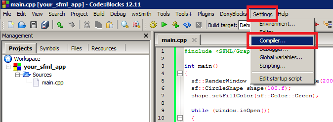
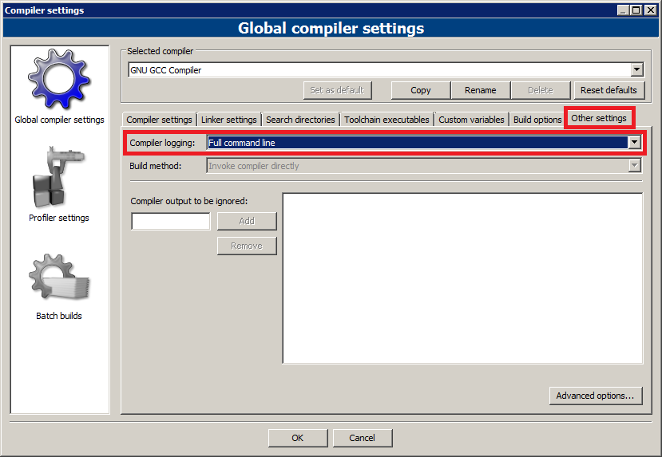
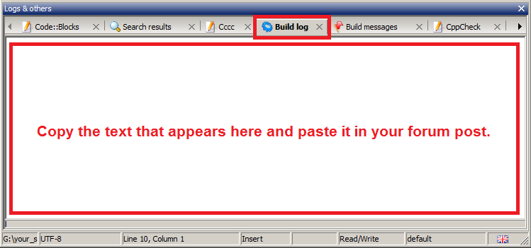
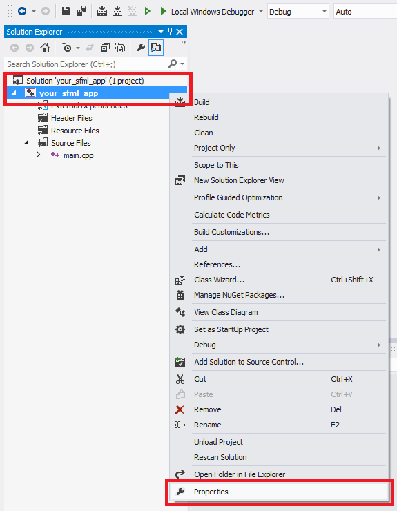
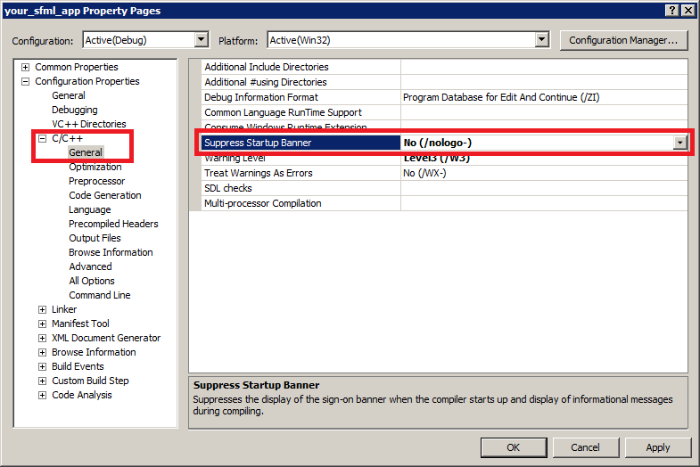
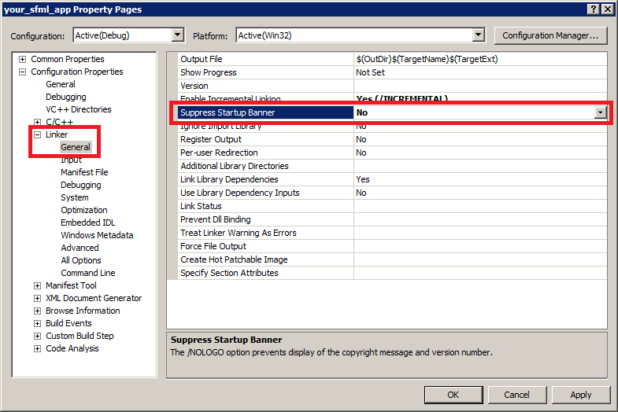
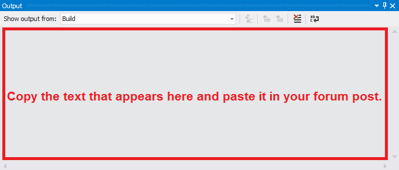

---
hide:
  - footer
---

# Troubleshooting

## General {: #grl}

### I'm having trouble using SFML {: #grl-trouble}

First, make sure that you have followed the installation instructions in the [official tutorials](../tutorials/3.1/index.md).

Have you:

- Provided the path to the SFML headers to your compiler?
- Provided the path to the SFML libraries to your linker?
- Included the headers for the modules you're using? (`SFML/[capitalized name of module].hpp`)
- Linked with the modules you're using? (See [What and how do I link to use SFML?](build-use.md#link))
- (Windows only) Copied the DLLs of the modules you're using, e.g. `sfml-graphics-3.dll`, next to your executable?
- (Linux only) Installed SFML, either through your package manager or with `cmake --install`?

If you've checked all of those, and SFML still refuses to work, see [I found a bug!](#grl-i-found-a-bug).

### SFML requires a newer CMake version than my OS provides! {: #grl-cmake-version}

SFML generally tracks the versions distributed with Debian and/or Ubuntu, as they're among the most popular distros, yet are the slowest to update.

Check the [CMakeLists.txt](https://github.com/SFML/SFML/blob/master/CMakeLists.txt) which CMake version SFML requires.
To update CMake, Kitware offers three options:

- On Ubuntu / Debian, use the provided [Kitware APT Repository](https://apt.kitware.com/)
- Use the provided binaries on the [CMake download page](https://cmake.org/download/)
- Build CMake from source

### I keep getting "undefined reference to <some strange thing that looks like an SFML function>" errors! {: #grl-undefined-ref}

See [What and how do I link to use SFML?](build-use.md#link)

If that doesn't help, see [How do I make my IDE output verbose build information?](#grl-verbose-ide)

If that also doesn't help, feel free to ask for assistance on the forum.

### How do I make my IDE output verbose build information? {: #grl-verbose-ide}

Often times, compiling/linking your project might fail for some reason.
Even after re-checking all your project settings and comparing it to what is described in the tutorials you still don't know the cause.
IDEs (Integrated Development Environments) are nothing but front-ends for the toolchain underneath of it.
All that IDEs (such as Code::Blocks, Visual Studio, Eclipse etc.) do is automate and generally make it easier for you to work on your projects from within a single environment, hence their name.
Without IDEs, you would have to resort to plain text editors to write your code and manually pass your source files to your compiler/linker on the command-line yourself.

One way an IDE makes your life simpler is by parsing the compiler/linker output and presenting it to you in a friendlier manner.
Often, clicking on an error will take you to the offending line for example.
What your IDE does "behind the scenes" when you click on the Build button or press your Build key is invoke a series of commands that you would also able to do yourself (but is simply tedious).
It then relays the generated text output, including all warnings and errors back to you after the commands have been run.
By default, most IDEs are set by default to not show the commands it runs behind the scenes to the user.
However, it is exactly this information that is helpful when building fails.
Thankfully, the IDEs let you specify whether you want to see these commands or not.

The commands are generated from your project configuration information that you set through the IDE user interface.
You might think that you set everything right in your project settings, but the only way of knowing for sure is by inspecting the commands that are run.
The command line will consist of a large number of flags and parameters.
Refer to the compiler/linker documentation if you want to understand them.
When asking for assistance in build-related matters on the forum, it is always recommended to provide the full build log (consisting of the commands and the raw output from the compiler/linker) to the other users.
It is a very compact way of providing information about your project configuration without having to make several screenshots of your IDE user interface.
Experienced users can very quickly spot from what you paste the mistake you made, if any.
Don't be surprised if you are immediately asked for this information.

#### Code::Blocks - all versions, all operating systems

First, open up your compiler settings window.



Go to the "Other settings" tab and change the "Compiler logging:" entry to "Full command line".



Try to build your project and change to the "Build log" tab when it completes.



Inspect the build log and see if it helps solve your problem.
If you need further help, you can ask on the forum.
In that case copy the output and paste it in your post.

#### Microsoft Visual Studio

The screenshots are from an older Visual Studio version, but the settings are still in the same place.

First, open up your project properties window.



Make sure you selected the configuration you are trying to build.
Open up the C/C++ -> General pane and change the "Suppress Startup Banner" entry to "No (/nologo-)".



Open up the Linker -> General pane and change the "Suppress Startup Banner" entry to "No".



Try to build your project.



Inspect the build log and see if it helps solve your problem.
If you need further help, you can ask on the forum.
In that case copy the output and paste it in your post.

#### Reminder

When posting on the forum, it is helpful to paste your log in `[code][/code]` tags to enable people to handle it easier.
Not only does it avoid line-breaks, it is also displayed in a monospace font which makes it easier to read if it spans multiple lines.

### Why do I get errors when mixing 32-bit and 64-bit libraries? {: #grl-64bit}

Every library you link has been built for a specific architecture, such as x86 (32-bit), x64 (64-bit) or ARM64, and all of them have to match the architecture your compiler is targeting.
Running a 64-bit operating system doesn't mean that your compiler automatically builds 64-bit executables.
For example, a 32-bit MinGW only builds 32-bit executables, and in Visual Studio the platform is selected per project configuration.
SFML doesn't add the architecture to its library file names, so you have to keep track of which package you downloaded or built.

When building with Visual Studio, the linker checks the architectures of all modules that are linked together and aborts with an error if they don't match:

```
fatal error LNK1112: module machine type 'X86' conflicts with target machine type 'x64'
```

It is possible that X86 and x64 are exchanged.

The linkers of GCC and Clang are less helpful.
They skip libraries with a mismatching architecture, which results in a large number of undefined references, and if you're lucky a "skipping incompatible" message.

To resolve this, make sure that everything matches.
If you are targeting x64 with your executable, make sure you are only using x64 libraries as well, and the same applies for x86 and ARM64.
Nowadays, 64-bit is the sensible default on all desktop platforms.

### My computer crashes when I run my SFML program! {: #grl-crash}

SFML was designed in a way that should not cause your computer to crash/freeze/hang/BSOD in any way.
If it does exhibit such behavior specifically when running your SFML program, it might be only indirectly because of SFML.

If you are using unstable drivers (still in beta or off a development branch in your package manager) chances are that they are the root cause of the problem.
The reason why they cause more problems with SFML than with other programs/games is mainly because OpenGL related bugs in drivers are given low priority over DirectX related bugs simply because the latter affect more games.
You'll just have to be patient and wait for the relevant bug to get fixed or revert to an older, more stable driver.

If you are not using unstable drivers, crashing might still be caused by over-clocking (either self-performed or automatic) of your hardware.
Try running everything at standard performance settings and see if that fixes the problem.
If your hardware comes over-clocked by default, search around the internet for other people who might be experiencing the same problems.
If this is the case you should contact your retailer/card manufacturer as this is a hardware related issue and you won't be able to do much on your own.

### I found a bug! {: #grl-i-found-a-bug}

Most of the time any unexpected behavior is a result of misunderstanding how to use SFML.
Out of many bug reports only few of them turn out to be real bugs **which are caused by SFML itself and nothing else**.

If you are using the latest SFML version, try building the latest master revision available on [GitHub](https://github.com/SFML/SFML/).
There are many things that might have already been fixed between the release which is available on the site and the latest development version.

If the bug is still present in the latest master version, try to produce a [minimal compilable code example](#grl-minimal) that displays the bug and nothing else.
That way the developers and others can focus on why it is occurring.

If you can reproduce what you think is a bug, if you have another computer at your disposal, try to run it there as well.
If the bug does not occur there, try to reconfigure the corresponding hardware/software settings on the first PC.
A lot of strange behavior is a result of misconfigured/faulty software/drivers.

!!! Warning

    Trying to report a bug that is a result of the usage of beta drivers is not a good idea.
    The source of the problem does not lie within the responsibility of the SFML developers and as such they can't do much to fix it themselves.

When you are sure that the bug is a result of SFML internals and is platform independent, you can go ahead and post in the forum of the package in question, and don't forget to provide a precise description of your problem, the version of SFML you're using, your system configuration, and the compilable code, and if the situation requires, the logs of your compiler and/or linker.
Also make sure that the bug hasn't already been reported (use the [search function](https://en.sfml-dev.org/forums/index.php?action=search)), confirmed (look on the [issue tracker](https://github.com/SFML/SFML/issues?q=is%3Aopen)) or even resolved in the latest source (check also the [closed issues](https://github.com/SFML/SFML/issues?q=is%3Aclosed)).

### What is a minimal code? {: #grl-minimal}

A minimal code example is a snippet of source code that is compilable with very little effort.

This implies that:

- it consists of a single file (no extra .h, .hpp or .cpp files)
- there are no special compiler/linker options that need to be set
- the provided code is specific to the matter at hand and does not do more than it needs to

Such an example should never have to be longer than 40 lines of code (including the header include lines which of course have to be provided as well) unless it only happens in very specific cases.

An example of minimal code:

```cpp
#include <SFML/Graphics.hpp>

int main()
{
    sf::RenderWindow window(sf::VideoMode({640, 480}), "Bug");

    // Some bug specific code here...

    while (window.isOpen())
    {
        while (const std::optional event = window.pollEvent())
        {
            if (event->is<sf::Event::Closed>())
                window.close();
        }

        // ... and here.

        window.clear();
        window.display();
    }
}
```

See also [the rules](https://en.sfml-dev.org/forums/index.php?topic=5559.msg36368#msg36368) for further details.

### And how can I easily obtain this minimal code? {: #grl-obtain-minimal}

Easy :

- Create a separate sandbox project with a single file consisting of a `main()` function
- Copy and paste your code into the body of the `main()` in such a way that it can compile
- One by one delete all lines which are not relevant to the actual problem and try to compile after every deletion to see if the problem still persists

Side note: This technique will often help you troubleshoot the problem on your own.

## Visual Studio {: #vs}

### My project crashes randomly, but I don't get any compiler or linker errors {: #vs-crash}

Make sure that you're linking against the correct version of the libraries for your project.
If you're compiling in Debug mode, you must link with the Debug versions of SFML, and vice-versa for Release mode.
To recall, the naming conventions for SFML are:

- `sfml-[module].lib` for the Release DLL
- `sfml-[module]-d.lib` for the Debug DLL
- `sfml-[module]-s.lib` for the static Release library
- `sfml-[module]-s-d.lib` for the static Debug library

If you link with the DLL versions, you must copy the required DLLs beside your executable:

- `sfml-[module]-3.dll` for Release
- `sfml-[module]-d-3.dll` for Debug

### I keep getting `fatal error LNK1112: module machine type 'XYZ' conflicts with target machine type 'ZYX'`. Help! {: #vs-arch}

See [Why do I get errors when mixing 32-bit and 64-bit libraries?](#grl-64bit).

## Windows {: #win}

### Why does a console attach itself to my project? {: #win-console}

In Windows, if you compile your project, you will have a console that attaches itself behind your window.
To avoid this, you must create the correct type of project or change its type after creation.
Many IDEs have options allowing you to choose whether you want to create a console or a GUI application.
It is however recommended to create an empty project and manually set its type afterwards.
This ensures that nothing else is set automatically that might cause strange behavior later on.

If you have already created the console project or created an empty one:

- In Code::Blocks, open the project options (Project Menu -> Properties).
In the Build targets tab, select the build target you wish to change on the left (most of the time only Debug and Release exist) and change its type option in the drop-down list on the right side from "Console application" to "GUI application".
- In Visual Studio, go to the project options (Project Menu -> Properties).
In the tree on the left, expand the "Configuration properties" tree and expand the "Linker" sub-tree.
Select "System" from the sub-tree, and in the SubSystem field on the right side change "Console (/SUBSYSTEM:CONSOLE)" to "Windows (/SUBSYSTEM:WINDOWS)" by clicking on the field and using the drop-down list.
- With CMake, add the WIN32 flag to your executable (`add_executable(name WIN32 ...)`).
This will do the same as the steps above.

To maintain a portable entry point (`int main()` function), you can link your program against `sfml-main.lib` in the case of Visual Studio or `libsfml-main.a` in the case of MinGW.
Using CMake, you can just make an if statement checking for WIN32 and add `SFML::Main` to your linked libraries.

Alternatively to hide the console, you can also define your own Windows entry point for graphical applications.

```cpp
int WINAPI WinMain(HINSTANCE hThisInstance, HINSTANCE hPrevInstance, LPSTR lpszArgument, int nCmdShow)
```

Replace your `int main()` or `int main(int argc, char** argv)` with this function and it will be called by the operating system when your program is executed just like the classical `int main()` function.

## Linux {: #lnx}

### (Debian) I can't compile the source code {: #lnx-compile}

Before anything else, make sure that you've followed the [official tutorial](../tutorials/3.1/index.md) and then check if the following packages have been installed:

- libx11-dev
- libxrandr-dev
- libxcursor-dev
- libxi-dev
- libudev-dev
- libgl1-mesa-dev
- libfreetype-dev
- libharfbuzz-dev
- libflac-dev
- libvorbis-dev
- libmbedtls-dev
- libssh2-1-dev

Though the library names might vary, especially regarding the version number.
