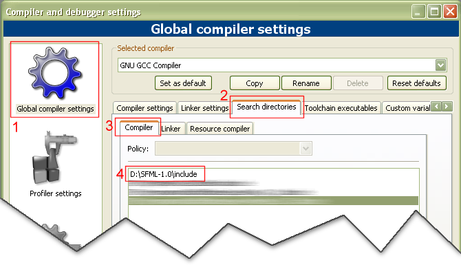
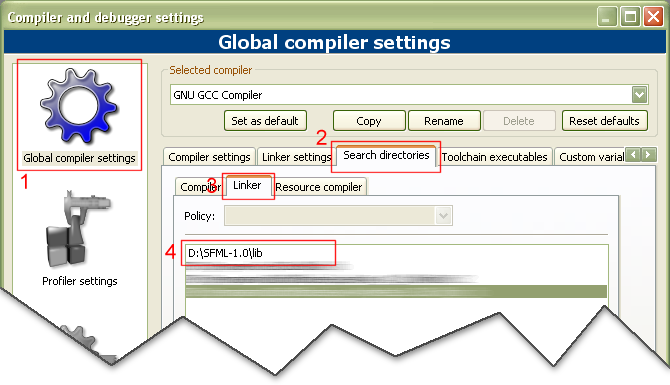
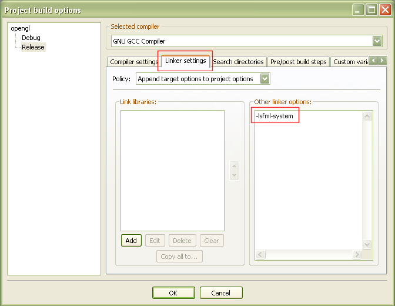
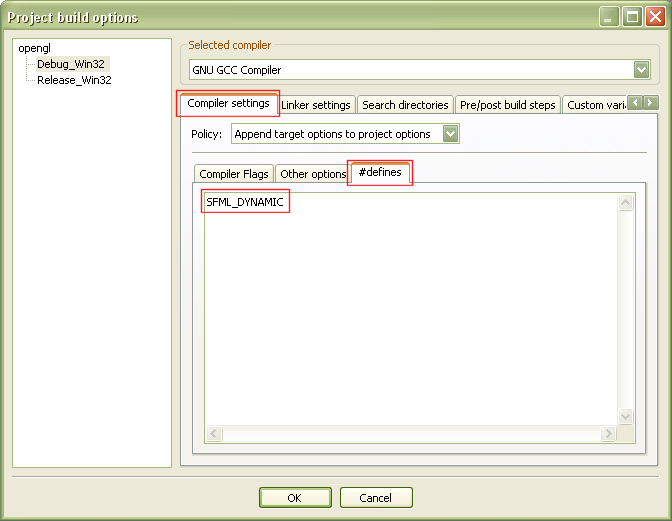

# SFML and Code::Blocks (MinGW)

!!! warning ""

    You're reading the tutorial for SFML 1.6. Check out the [latest version of this tutorial](/tutorials/latest/getting-started/code-blocks/).

## Introduction

This tutorial is the first one you should read if you're using SFML with the Code::Blocks EDI, and the GCC compiler (this is the default one). It will explain how to install SFML, setup your IDE, and compile a SFML program.  
Compiling SFML libraries is also explained, for more advanced users (although it's quite simple).

## Installing SFML

**Important**: this release of SFML was compiled with gcc 4.4, if your own version doesn't match and is incompatible, you'll have to recompile SFML.

First, you must download the SFML development files. You can download the minimal package (libraries + headers), but it is recommended that you download the full SDK, which contains samples and documentation as well.  
These packages can be found on the [download page](../../../download/index.md "Go to the download page").

Once you have downloaded and extracted the files to your hard drive, you must make the SFML headers and library files available for Code::Blocks. There are two ways of doing it :

#### Copy the SFML development files to your Code::Blocks installation directory

- Copy SFML-x.y\include\SFML to the \include directory of your Code::Blocks installation (so that you obtain include\SFML)
- Copy the *.a files in SFML-x.y\lib to the \lib directory of your Code::Blocks installation

#### Leave the SFML files where you want, and setup Code::Blocks so that it can find them

- Go to the *Settings / Compiler and debugger* menu, then to *Global compiler settings / Search directories*
- In *Compiler*, add SFML-x.y\include
- In *Linker*, add SFML-x.y\lib





## Compiling your first SFML program

Create a new "Console application" project using the GCC compiler, and write a SFML program. For example, you can try the [`sf::Clock`](../../../documentation/1.6/classsf_1_1Clock.html "sf::Clock documentation") class of the System package :

```cpp
#include <SFML/System.hpp>
#include <iostream>

int main()
{
    sf::Clock Clock;
    while (Clock.GetElapsedTime() < 5.f)
    {
        std::cout << Clock.GetElapsedTime() << std::endl;
        sf::Sleep(0.5f);
    }

    return 0;
}
```

Don't forget that all SFML classes and functions are in the `sf` namespace.

Open your project's build options, then go to the *Linker settings* tab. In *Other link options*, add the SFML libraries you are using, with the "-l" directive. Here we only use libsfml-system.a, so we add "-lsfml-system". For the Debug configuration, you can link with the debug versions of the libraries, which have the "-d" suffix ("-lsfml-system-d" in this case).  
This is for the dynamic version of the libraries, the one using the DLLs. If you want to link with the static version of the libraries, add the "-s" suffix : -lsfml-system-s, or -lsfml-system-s-d for the debug version.



When linking to multiple SFML libraries, make sure you link them in the right order, as it's important for MinGW. The rule is the following : if library XXX depends on (uses) library YYY, put XXX first and then YYY. An exemple with SFML : sfml-graphics depends on sfml-window, and sfml-window depends an sfml-system. The link options would be as follows :

```cpp
-lsfml-graphics
-lsfml-window
-lsfml-system
```

Basically, every SFML library depends on sfml-system, and sfml-graphics also depends on sfml-window. That's it for dependencies.

Your program should now compile, link and run fine. If you linked against the dynamic versions of the SFML libraries, donc forget to copy the corresponding DLLs (sfml-system.dll in this case) to your executable's directory, or to a directory contained in the PATH environment variable.

**Important**: if you link against dynamic libraries, you also need to define the **SFML_DYNAMIC** macro in your project's settings. If you don't, you will get linker errors when compiling your application.



If you are using the Audio package, you must also copy the DLLs of the external libraries needed by it, which are libsndfile-1.dll, and OpenAL32.dll.  
These files can be found in the extlibs\bin directory of the package that you downloaded (SDK or development files).

## Compiling SFML

If the precompiled SFML libraries don't exist for your system, or if you want to use the latest sources from SVN, you can compile SFML quite easily. In such case, no test have been made so you are encouraged to report any failure or success encountered during your compile process. If you succeed compiling SFML for a new platform, please contact the development team so that we can share the files with the community.

To compile SFML libraries and samples, you must first download and install the full SDK (or retrieve the files from the SVN repository).

Go to SFML-x.y\build\codeblocks, and open the file SFML.workspace. Choose the configuration you want to build (Debug or Release, Static or DLL), and clic "build workspace". This should create the corresponding SFML library files in the lib directory, as well as the sample executables.

If Qt and wxWidgets are not installed on your system, you may get compile errors with the corresponding samples ; just ignore them.

Compiling SFML static libraries with MinGW requires an extra-step if you want to include the external libraries as well. If you don't do it, you will have to explicitly link with the external libraries used by SFML in each of your programs.  
Unfortunately Code::Blocks can't perform this step automatically, but a batch script named build.bat exists in SFML-x.y\build\codeblocks\batch-build. This script automatically compiles the SFML libraries for all configurations (debug/release static/dynamic) and performs the extra step required for static libraries. All you have to do before running it is to make your Code::Blocks executable (codeblocks.exe) available, i.e. add its path to the PATH environment variable.
