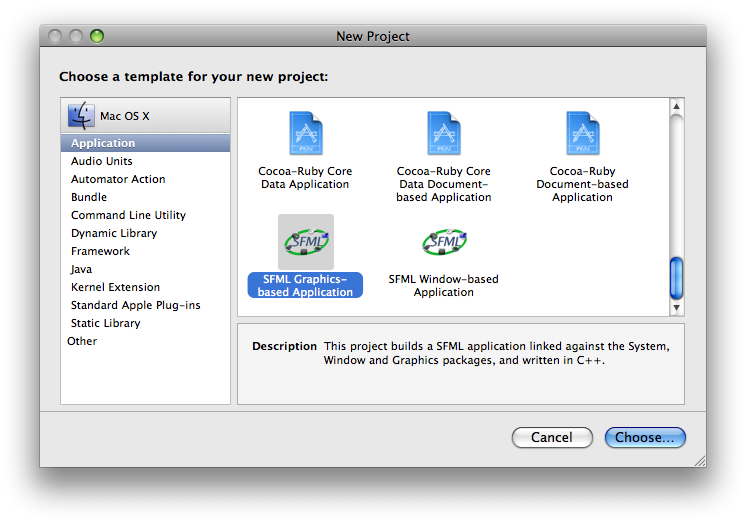

# SFML et Xcode (Mac OS X)

!!! warning ""

    Vous lisez le tutoriel pour SFML 1.6. Consultez la [dernière version de ce tutoriel](/fr/tutorials/latest/getting-started/macos/).

## Introduction

Ce tutoriel est le premier que vous devriez lire si vous utilisez SFML avec l'EDI Xcode et le compilateur GCC (celui par défaut). Il va vous expliquer comment installer SFML, paramétrer votre EDI, et compiler un programme SFML. La compilation des bibliothèques SFML est également expliquée, pour les utilisateurs plus expérimentés.

A noter que la version 32 bits de SFML est prévue pour fonctionner sur tout Mac Intel ou PPC utilisant Mac OS X 10.4 ou ultérieur. La version 64 bits fonctionne quant à elle à partir de Mac OS X 10.5.

## Installer SFML

Premièrement, vous devez télécharger les fichiers de développement SFML. Vous pouvez télécharger l'archive minimale (bibliothèques + en-têtes), mais il est recommandé de télécharger le SDK complet, qui contient en plus les exemples et la documentation. Si vous utilisez Mac OS X 10.6 ou ultérieur, préférez la version 64 bits ; sinon prenez la version 32 bits.  
Toutes les archives mentionnées peuvent être trouvées sur la [page des téléchargements](../../../download/index.md "Aller sur la page des téléchargements").

Une fois que vous avez téléchargé et extrait les fichiers sur votre disque dur, copiez le contenu du dossier SFML-x.y/lib (ou lib64 dans le cas de la version 64 bits) dans le répertoire /Bibliothèque/Frameworks. Rendez-vous ensuite dans le dossier SFML-x.y/extlibs/bin. Si vous avez choisi la version 32 bits, copiez les dossiers OpenAL.framework et sndfile.framework dans le répertoire /Bibliothèque/Frameworks. Dans le cas de la version 64 bits, copiez uniquement le contenu du dossier x86_64. L'installation minimale est terminée.

Cependant, pour vous faciliter la tâche, vous avez à disposition des modèles de projets (*templates*) pour Xcode. Afin de pouvoir utiliser ces modèles, copiez les dossiers "SFML Window-based Application" et "SFML Graphics-based Application" du dossier SFML-x.y/build/xcode/templates dans "/Developer/Library/Xcode/Project Templates/Application", et le dossier "SFML Tool" dans "/Developer/Library/Xcode/Project Templates/Command Line Utility".

## Créer votre premier programme SFML

Lancez Xcode, et choisissez le menu "File" > "New Project...".

Sélectionnez la sous-partie "Application" dans la colonne de gauche. Voici ce que vous devez observer :

Sélectionnez l'un des projets SFML et cliquez sur "Choose...". Vous serez invité à donner un nom à votre projet, ce sera aussi le nom de votre programme.

Pour tester le programme, cliquez sur le bouton "Build and Go" de la barre d'outils dans la fenêtre du projet. Et voilà votre application créée !

Quelques explications par rapport à l'organisation du projet :

- Le dossier de référence "Sources" contient les fichiers source de votre programme. Vous pouvez ajouter les vôtres à cet endroit.
- Le dossier de référence "Frameworks" contient tous les frameworks utilisés pour votre projet. Ici vous pouvez constater que les modules sfml-system, sfml-window et sfml-graphics ont été ajoutés. Le paquet "SFML.framework" est là uniquement pour que vous puissiez accéder rapidement aux fichiers d'en-tête de SFML. Il n'est pas utilisé par le programme, contrairement aux frameworks sfml-system, sfml-window et sfml-graphics. C'est ici que vous rajouterez les frameworks des autres modules SFML dont vous avez besoin. Pour ce faire, glissez simplement le paquet sfml-xxx.framework depuis le Finder dans ce dossier de référence.

Dans le cas où vous voudriez créer un exécutable au lieu d'une application, le modèle "SFML Tool" est disponible dans la partie "Command Line Utility" du panneau de création d'un nouveau projet. Celui-ci ne contient aucun code de base excepté la fonction principale, et est lié par défaut au module sfml-system.

## Distribuer votre application

Afin de faire profiter de vos logiciels à d'autres utilisateurs, vous devez vous assurer que le système d'exploitation trouvera les bibliothèques et/ou frameworks dont dépend votre programme. Dans cette optique, deux possibilités s'offrent à vous : soit vous choisissez d'installer les bibliothèques / frameworks dans les dossiers par défaut du système, soit vous les intégrez à l'intérieur de l'application.

### Installer les bibliothèques / frameworks dans les dossiers par défaut du système

Cette méthode présente l'avantage d'éviter les copies multiples des bibliothèques SFML. En effet, une fois installée, votre bibliothèque peut être utilisée sans problème par de multiples applications. De plus, mettre à jour cette unique bibliothèque pourra bénéficier à toutes les applications qui l'utilisent. En revanche, cela présente également deux inconvénients : d'une part la bibliothèque sera séparée de son programme, ce qui veut dire une étape d'installation supplémentaire afin que votre application soit opérationnelle ; d'autre part les dossiers de destination ne sont accessibles en écriture que par les comptes administrateurs.  
**Mise en oeuvre** : installez les frameworks dont votre application se sert dans le dossier /Bibliothèque/Frameworks, et éventuellement les bibliothèques dont elle se sert dans le dossier /usr/local/lib. Cette opération devra être effectuée par chaque utilisateur voulant profiter de votre programme.

### Intégrer les bibliothèques / frameworks à votre application

Cette seconde méthode a pour avantage de simplifier les étapes d'installation (copier l'application suffit) et ne pose plus de problème de droits d'utilisateurs. Cependant, chaque application utilisant SFML aura sa propre copie des bibliothèques, une mise à jour de celles-ci devra donc être répercutée sur chacune de ces applications. Ce n'est donc pas la situation la plus adaptée dans le cas du développeur.  
**Mise en oeuvre** : avec Xcode, utilisez la *[Copy Files Build Phase](http://developer.apple.com/DOCUMENTATION/DeveloperTools/Conceptual/XcodeBuildSystem/200-Build_Phases/bs_build_phases.html#//apple_ref/doc/uid/TP40002690-CJAHHAJI "Documentation sur la Copy Files Build Phase")* en sélectionnant "Frameworks" comme "Destination" si vous utilisez des frameworks, et "Exécutables" si vous utilisez des bibliothèques. Glissez ensuite les fichiers concernés dans cette phase de création. Il ne vous reste plus qu'à lancer la création de votre application.

A vous de choisir ce qui vous convient le mieux.

Remarque : aucun des modules de SFML ne nécessite de bibliothèque qui ne soit déjà présente par défaut sur Mac OS X, excepté le module Audio qui requiert les bibliothèques OpenAL et libsndfile. Vous devrez donc aussi les fournir avec votre application (voir le dossier extlibs/bin de l'image de disque téléchargée). Si vous utilisez la version 64 bits de SFML, vous n'avez pas besoin de fournir le framework OpenAL. À noter que vous pouvez constater la présence du framework OpenAL dans les dossiers du système, cependant la version présente sur Mac OS X 10.4 présente des disfonctionnements, c'est pourquoi une version recompilée vous est fournie.

## Compiler SFML (pour les utilisateurs avancés)

Pour compiler les frameworks SFML et les exemples, vous devez tout d'abord télécharger le SDK complet (voir la [page des téléchargements](../../../download/index.md "Aller sur la page des téléchargements")).

Rendez-vous dans le répertoire SFML-x.y/build/xcode et ouvrez le projet SFML.xcodeproj (compatible avec Xcode 2.4 et ultérieur). Selon vos besoins, choisissez le style Debug ou Release, puis lancez la compilation. Elle peut durer une à plusieurs minutes selon la puissance de l'ordinateur. Vous trouverez tous les frameworks produits dans le dossier SFML-x.y/lib (ou SFML-x.y/lib64 si vous avez choisi de compiler SFML pour les processeurs 64 bits à l'aide du projet "SFML with Intel 64 bits.xcodeproj").

De même si vous souhaitez créer des bibliothèques dynamiques brutes, vous avez à disposition le projet SFML-bare.xcodeproj. Effectuez les mêmes actions que pour la compilation des frameworks afin de produire des bibliothèques dynamiques (fichier portant l'extension "dylib") que vous pourrez retrouver dans le même dossier SFML-x.y/lib.

Pour compiler les exemples, ouvrez le projet SFML-x.y/samples/build/xcode/samples.xcodeproj et lancez la compilation. Les programmes créés sont placés dans le répertoire SFML-x.y/samples/bin. À noter que pour lancer les exemples, vous devez avoir installé les frameworks comme indiqué dans ce tutoriel.
