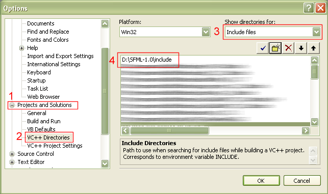
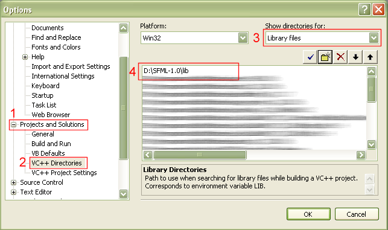
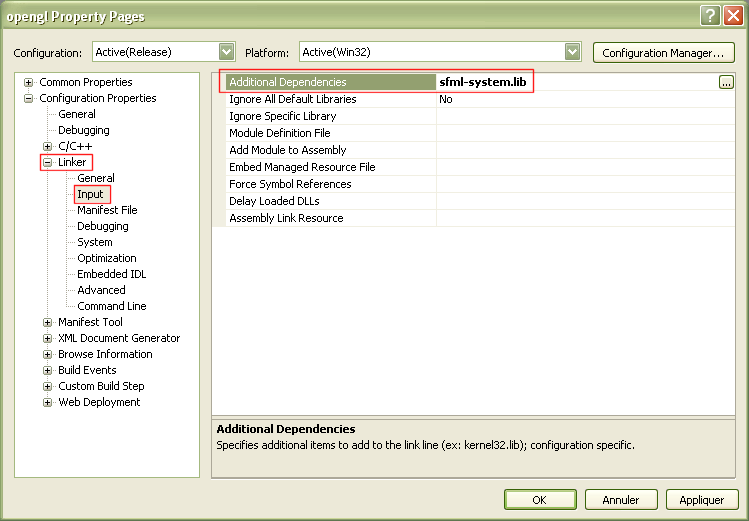
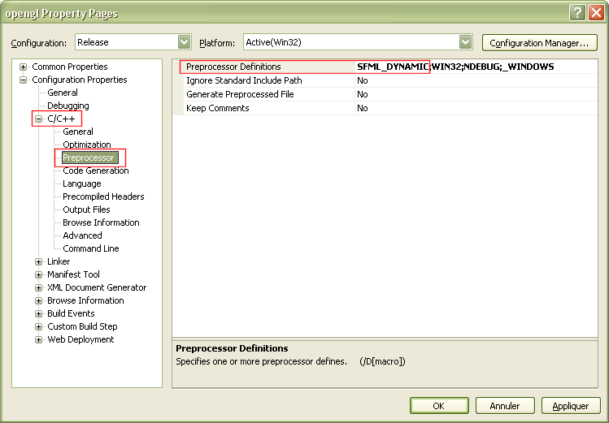

# SFML et Visual Studio

!!! warning ""

    Vous lisez le tutoriel pour SFML 1.6. Consultez la [dernière version de ce tutoriel](/fr/tutorials/latest/getting-started/visual-studio/).

## Introduction

Ce tutoriel est le premier que vous devriez lire si vous utilisez SFML avec le compilateur Visual C++. Il va vous expliquer comme installer SFML, paramétrer votre EDI, et compiler un programme SFML.  
La compilation des bibliothèques SFML est également expliquée, pour les utilisateurs plus expérimentés (bien que ce soit relativement simple).

SFML est maintenue sous VC++ 2008 Professionnel, mais les explications suivantes sont valides pour d'autres versions telles que les éditions express, VC++ 2010, VC++ 2005, VC++ 2003 ou même VC++ 6.

## Installer SFML

Premièrement, vous devez télécharger les fichiers de développement de SFML. Vous pouvez télécharger l'archive minimale (bibliothèques + en-têtes), mais il est recommandé de télécharger le SDK complet, qui contient en plus les exemples et la documentation.  
Ces archives peuvent être trouvées sur la [page de téléchargements](../../../download/index.md "Aller à la page de téléchargements").

Une fois que vous avez téléchargé et extrait les fichiers sur votre disque dur, vous devez faire en sorte que Visual C++ trouve les fichiers en-têtes et bibliothèques de SFML. Il y a deux façons de le faire :

#### Copiez les fichiers de développement SFML directement dans le répertoire d'installation de Visual Studio

- Copiez SFML-x.y\include\SFML vers le répertoire VC\include de votre installation de Visual Studio (de manière à obtenir VC\include\SFML)
- Copiez les fichiers *.lib de SFML-x.y\lib vers le répertoire VC\lib de votre installation de Visual Studio

#### Laissez les fichiers SFML où vous voulez, et paramétrez Visual Studio pour qu'il les trouve

- Allez dans le menu *Tools / Options*, puis dans *Projects and Solutions / VC++ Directories*
- Dans *Include files*, ajoutez SFML-x.y\include
- Dans *Library files*, ajoutez SFML-x.y\lib





## Compiler votre premier programme SFML

Créez un nouveau projet "Win32 console application", et écrivez un programme SFML. Par exemple, vous pouvez essayer la classe [`sf::Clock`](https://www.sfml-dev.org/documentation/1.6-fr/classsf_1_1Clock.php "sf::Clock documentation") du module système :

```cpp
#include <SFML/System.hpp>
#include <iostream>

int main()
{
    sf::Clock Clock;
    while (Clock.GetElapsedTime() < 5.f)
    {
        std::cout << Clock.GetElapsedTime() << std::endl;
        sf::Sleep(0.5f);
    }

    return 0;
}
```

N'oubliez pas que toutes les classes et fonctions SFML se trouvent dans l'espace de nommage `sf`.

Ouvrez les options de votre projet, puis allez dans le menu *Linker / Input*. A la ligne *Additional dependencies*, ajoutez les bibliothèques SFML que vous utilisez. Ici nous n'utilisons que sfml-system.lib.  
Ca c'est pour les bibliothèques dynamiques, celles qui nécessiteront les DLLs correspondantes. Si vous souhaitez plutôt lier avec les versions statiques des bibliothèques SFML, vous pouvez utiliser le préfixe "-s" : sfml-system-s.lib, ou sfml-system-s-d.lib pour la version debug.

**Important** : pour la configuration Debug, il est impératif de lier avec les versions de débogage des bibliothèques SFML, qui sont suffixées par "-d" (sfml-system-d.lib ou sfml-system-s-d.lib dans ce cas). En effet, mélanger configurations Debug et Release peut résulter en de multiples erreurs ou crashs.



Votre programme devrait maintenant compiler, lier et s'exécuter sans problème. Si vous avez lié avec la version dynamique des bibliothèques SFML, n'oubliez pas de copier les DLLs correspondantes (sfml-system.dll dans ce cas) dans le répertoire de votre exécutable, ou dans un répertoire contenu dans la variable d'environnement PATH.

**Important** : si vous utilisez les bibliothèques dynamiques, vous devrez également définir la macro **SFML_DYNAMIC** dans les options de votre projet. Si vous oubliez cette étape, vous aurez droit à des erreurs d'édition de liens.



Si vous utilisez le module Audio, vous devez également copier les DLLs des bibliothèques externes qu'il utilise, qui sont libsndfile-1.dll et OpenAL32.dll.  
Ces fichiers peuvent être trouvés dans le répertoire extlibs\bin de l'archive que vous avez téléchargée (SDK ou fichiers de développement).

## Compiler SFML

Si les bibliothèques précompilées de SFML n'existent pas pour votre système, ou si vous souhaitez utiliser les toutes dernières sources via SVN, vous pouvez compiler SFML assez facilement. Dans de tels cas, aucun test n'a été effectué et nous vous encourageons donc à rapporter tout échec ou succès rencontré durant le processus de compilation. Si vous réussissez à compiler SFML pour une nouvelle plateforme, nous vous invitons à contacter l'équipe de développement afin que nous puissions partager les fichiers avec la communauté.

Pour compiler les bibliothèques SFML et les exemples, vous devez tout d'abord télécharger et installer le SDK complet (ou récupérer les fichiers nécessaires à partir du dépôt SVN).

Allez dans le répertoire SFML-x.y\build\vc2005 (ou SFML-x.y\build\vc2008 si vous utilisez VC++ 2008), et ouvrez le fichier SFML.sln. Choisissez la configuration que vous souhaitez construire (Debug ou Release, Static ou DLL) puis cliquez sur "build". Cela devrait créer les bibliothèques SFML correspondantes dans le répertoire lib, ainsi que les exécutables des exemples.

Si Qt et wxWidgets ne sont pas installés sur votre système, vous devriez avoir des erreurs de compilation avec les exemples correspondants ; ignorez les simplement.
