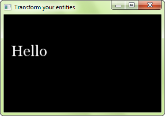
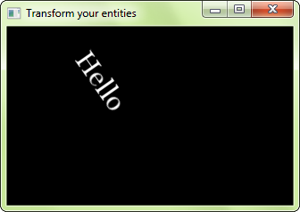
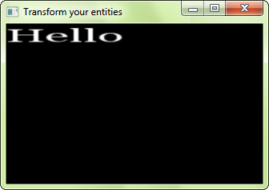
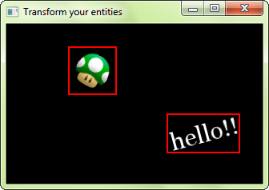

# Position, rotation, échelle : transformer des entités

!!! warning ""

    Vous lisez le tutoriel pour SFML 2.0. Consultez la [dernière version de ce tutoriel](/fr/tutorials/latest/graphics/transform/).

## Transformer des entités SFML

Toutes les classes de SFML (sprites, texte, formes) utilisent la même interface pour les transformations : [`sf::Transformable`](../../../documentation/2.0/classsf_1_1Transformable.html "sf::Transformable documentation"). Cette classe de base définit une API simple pour positionner, tourner et redimensionner vos entités. Elle n'offre pas une flexibilité maximale, mais définit plutôt une interface qui soit facile à comprendre et à utiliser, et qui couvre 99% des cas d'utilisation -- pour les 1% restant, voyez les derniers chapitres.

[`sf::Transformable`](../../../documentation/2.0/classsf_1_1Transformable.html "sf::Transformable documentation") (et toutes ses classes dérivées) définit quatre propriétés : **position**, **rotation**, **échelle** et **origine** ; elles ont toutes leur *getter* et leur *setter*. Ces composantes de transformation sont toutes indépendantes les unes des autres : si vous voulez modifier l'orientation de l'entité, vous avez juste à changer sa propriété 'rotation' sans vous préoccuper de la position ou de l'échelle courante.

### Position

La position est la... position de l'entité dans le monde 2D. Je ne pense pas que cela mérite plus d'explications :)

```cpp
// 'entity' peut être un sf::Sprite, un sf::Text, un sf::Shape ou n'importe quelle autre classe transformable

// change la position absolue de l'entité
entity.setPosition(10, 50);

// déplace l'entité relativement à sa position actuelle
entity.move(5, 5);

// récupère la position absolue de l'entité
sf::Vector2f position = entity.getPosition(); // = (15, 55)
```



Par défaut, les entités sont positionnées par rapport à leur coin haut-gauche ; nous verrons plus tard comment changer cela avec la propriété 'origine'.

### Rotation

La rotation est l'orientation de l'entité dans le monde 2D. Elle est définie en *degrés*, dans le sens des aiguilles d'une montre (car l'axe Y pointe vers le bas avec SFML).

```cpp
// 'entity' peut être un sf::Sprite, un sf::Text, un sf::Shape ou n'importe quelle autre classe transformable

// change la rotation absolue de l'entité
entity.setRotation(45);

// tourne l'entité relativement à son orientation actuelle
entity.rotate(10);

// récupère la rotation absolue de l'entité
float rotation = entity.getRotation(); // = 55
```



Notez que SFML renvoie toujours un angle entre 0 et 360 lorsque vous appelez `getRotation`.

De même que pour la position, la rotation s'effectue par défaut autour du coin haut-gauche, mais cela peut être changé avec l'origine.

### Echelle

Le facteur d'échelle permet de redimensionner l'entité. L'échelle par défaut est 1, plus que 1 agrandit l'entité, moins que 1 la réduit. Les facteurs d'échelle négatifs sont autorisés, ce qui permet de faire des symétries des entités.

```cpp
// 'entity' peut être un sf::Sprite, un sf::Text, un sf::Shape ou n'importe quelle autre classe transformable

// change l'échelle absolue de l'entité
entity.setScale(4.0f, 1.6f);

// redimensionne l'entité relativement à son échelle actuelle
entity.scale(0.5f, 0.5f);

// récupère l'échelle absolue de l'entité
sf::Vector2f scale = entity.getScale(); // = (2, 0.8)
```



### Origine

L'origine est le centre des trois autres transformations. La position est la position de l'origine, la rotation est effectuée autour de l'origine, et l'échelle est appliquée autour de l'origine également. Par défaut, l'origine est le coin haut-gauche de l'entité (son point (0, 0)), mais vous pouvez la modifier de sorte qu'elle soit le centre ou un autre coin, par exemple.

Afin que l'API reste simple, il n'y a qu'une origine pour les trois composantes de transformation. Ce qui signifie que vous ne pouvez pas, par exemple, positionner une entité relativement à son coin haut-gauche tout en la tournant autour de son centre. Si vous avez réellement besoin de faire ce genre de choses, jetez un oeil aux chapitres suivants.

```cpp
// 'entity' peut être un sf::Sprite, un sf::Text, un sf::Shape ou n'importe quelle autre classe transformable

// change l'origine de l'entité
entity.setOrigin(10, 20);

// récupère l'origine de l'entité
sf::Vector2f origin = entity.getOrigin(); // = (10, 20)
```

Notez que le fait de changer l'origine modifie également la position de l'entité à l'écran, bien que sa propriété 'position' soit toujours la même. Si vous ne comprenez pas pourquoi, relisez ce tutoriel !

## Transformez vos propres classes

[`sf::Transformable`](../../../documentation/2.0/classsf_1_1Transformable.html "sf::Transformable documentation") n'est pas seulement faite pour les classes SFML, elle peut aussi servir de base (ou de membre) à vos propres classes.

```cpp
class MyGraphicalEntity : public sf::Transformable
{
    // ...
};

MyGraphicalEntity entity;
entity.setPosition(10, 30);
entity.setRotation(110);
entity.setScale(0.5f, 0.2f);
```

Pour utiliser la transformation finale de l'entité (par exemple pour la dessiner), il faut appeler la fonction `getTransform`. Celle-ci renvoie un [`sf::Transform`](../../../documentation/2.0/classsf_1_1Transform.html "sf::Transform documentation") ; voyez le prochain chapitre pour plus d'explications concernant cette classe, et comment l'utiliser pour transformer une entité SFML.

Si vous n'avez pas besoin de la totalité des fonctions fournies par [`sf::Transformable`](../../../documentation/2.0/classsf_1_1Transformable.html "sf::Transformable documentation"), ou bien n'en voulez pas pour fournir votre propre interface publique, n'hésitez pas à l'utiliser en tant que membre, et à fournir vos propres fonctions par dessus les siennes. Elle n'est pas abstraite donc il n'y a aucun problème à l'instancier plutôt que de l'utiliser en tant que classe de base.

## Les transformations quelconques

La classe [`sf::Transformable`](../../../documentation/2.0/classsf_1_1Transformable.html "sf::Transformable documentation") est facile à utiliser, mais elle est également limitée. Certains utilisateurs auront besoin de plus de flexibilité, ils voudront définir une transformation finale comme étant une combinaison quelconque de transformations de base. Pour cette catégorie d'utilisateurs, une classe de plus bas niveau est disponible : [`sf::Transform`](../../../documentation/2.0/classsf_1_1Transform.html "sf::Transform documentation"). Elle n'est rien de plus qu'une matrice 3x3 encapsulée, elle peut donc représenter n'importe quelle transformation 2D.

Il y a plusieurs façons de construire un [`sf::Transform`](../../../documentation/2.0/classsf_1_1Transform.html "sf::Transform documentation") :

- en utilisant les fonctions prédéfinies pour les transformations les plus communes (translation, rotation, échelle)
- en combinant deux [`sf::Transform`](../../../documentation/2.0/classsf_1_1Transform.html "sf::Transform documentation")
- en donnant ses 9 composantes directement

Voici quelques exemples :

```cpp
// la transformation identité (ne fait rien)
sf::Transform t1 = sf::Transform::Identity;

// une rotation
sf::Transform t2;
t2.rotate(45);

// une matrice 3x3
sf::Transform t3(2, 0, 20,
                 0, 1, 50,
                 0, 0, 1);

// une combinaison de transformations
sf::Transform t4 = t1 * t2 * t3;
```

Vous pouvez bien entendu appliquer plusieurs transformations de base au même [`sf::Transform`](../../../documentation/2.0/classsf_1_1Transform.html "sf::Transform documentation"), celles-ci seront toutes combinées séquentiellement :

```cpp
sf::Transform t;
t.translate(10, 100);
t.rotate(90);
t.translate(-10, 50);
t.scale(0.5f, 0.75f);
```

Mais revenons à nos moutons : comment une telle transformation peut-elle être appliquée à une entité graphique ? C'est facile : passez-la à la fonction `draw`.

```cpp
window.draw(entity, transform);
```

... ce qui est en fait un raccourci pour :

```cpp
sf::RenderStates states;
states.transform = transform;
window.draw(entity, states);
```

Si votre entité est un [`sf::Transformable`](../../../documentation/2.0/classsf_1_1Transformable.html "sf::Transformable documentation") (sprite, texte, forme), avec sa propre transformation interne, alors les deux sont combinées pour produire la transformation finale.

## Boîtes englobantes

Après avoir transformé et dessiné vos entités, vous voudrez certainement effectuer certains calculs avec elles, comme par exemple détecter les collisions.

Les entités SFML peuvent vous donner leur boîte englobante. La boîte englobante est le rectangle minimal qui contient l'entité, et dont les côtés sont alignés sur les axes X et Y.



La boîte englobante est très pratique pour implémenter la détection de collisions : elle peut être rapidement testée avec un point ou avec une autre boîte englobante, et elle représente une assez bonne approximation de l'entité réelle.

```cpp
// récupération de la boîte englobante de l'entité
sf::FloatRect boundingBox = entity.getGlobalBounds();

// test de collision avec un point
sf::Vector2f point = ...;
if (boundingBox.contains(point))
{
    // collision!
}

// test de collision avec un autre rectangle (comme par exemple la boîte englobante d'une autre entité)
sf::FloatRect otherBox = ...;
if (boundingBox.intersects(otherBox))
{
    // collision!
}
```

La fonction est nommée `getGlobalBounds` car elle renvoie la boîte englobante de l'entité dans le système de coordonnées global, c'est-à-dire avec toutes ses transformations (position, rotation, échelle) appliquées.

Il existe une autre fonction, qui renvoie la boîte englobante de l'entité dans son système de coordonnées *local* (sans les transformations) : `getLocalBounds`. Cette fonction peut être utilisée pour récupérer la taille initiale de l'entité, par exemple, ou bien pour effectuer des calculs plus spécifiques.

## Les hiérarchies d'objets (scenegraph)

Avec les transformations persos vues précédemment, il est maintenant facile d'implémenter une hiérarchie d'objets, où les enfants sont transformés relativement à leur parent. Tout ce que vous avez à faire est de passer la transformation combinée du parent aux enfants lorsque vous les dessinez, jusqu'à ce que vous atteignez les entités dessinables finales (sprites, textes, formes, vertex arrays ou bien vos propres 'drawables').

```cpp
// la classe de base abstraite
class Node
{
public:

    // ... fonctions pour transformer le noeud

    // ... fonction pour gérer les enfants du noeud

    void draw(sf::RenderTarget& target, const sf::Transform& parentTransform) const
    {
        // on combine la transformation du parent avec la transformation du noeud
        sf::Transform combinedTransform = parentTransform * m_transform;

        // on laisse le noeud se dessiner
        onDraw(target, combinedTransform);

        // on dessine ses enfants
        for (std::size_t i = 0; i < m_children.size(); ++i)
            m_children[i]->draw(target, combinedTransform);
    }

private:

    virtual void onDraw(sf::RenderTarget& target, const sf::Transform& transform) const = 0;

    sf::Transform m_transform;
    std::vector<Node*> m_children;
};

// une classe dérivée simple : un noeud qui dessine un sprite
class SpriteNode : public Node
{
public:

    // .. fonctions pour paramétrer le sprite

private:

    virtual void onDraw(sf::RenderTarget& target, const sf::Transform& transform) const
    {
        target.draw(m_sprite, transform);
    }

    sf::Sprite m_sprite;
};
```
