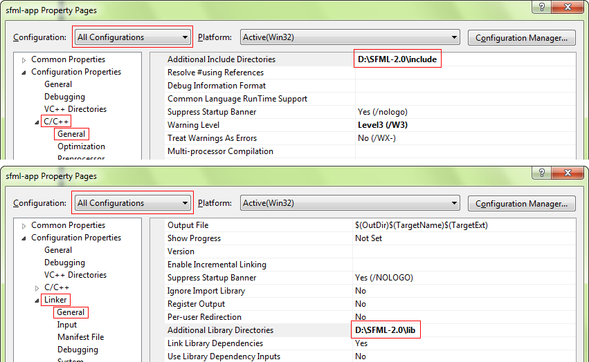
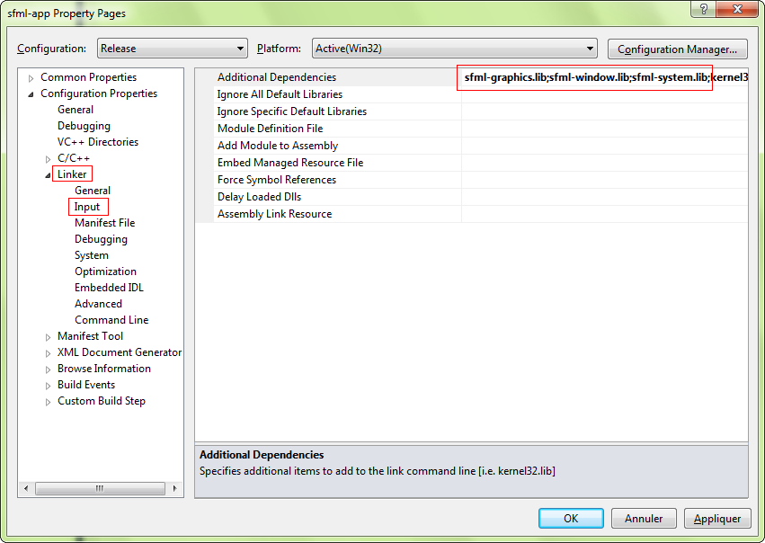
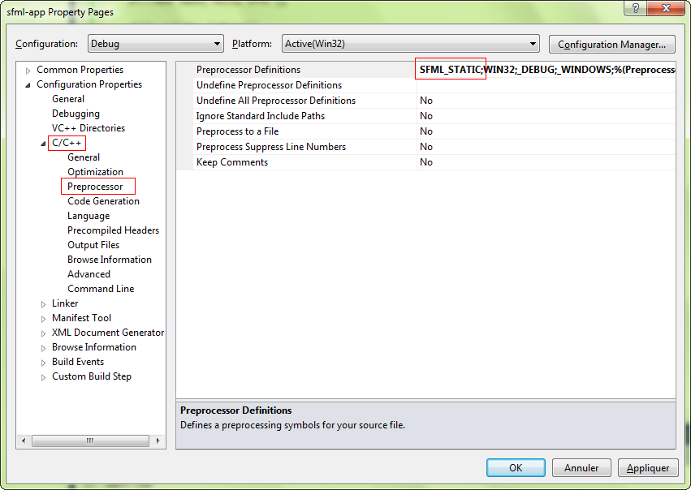
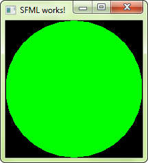

# SFML et Visual studio

!!! warning ""

    Vous lisez le tutoriel pour SFML 2.1. Consultez la [dernière version de ce tutoriel](/fr/tutorials/latest/getting-started/visual-studio/).

## Introduction

Ce tutoriel est le premier que vous devriez lire si vous utiliser SFML avec l'EDI Visual Studio (compilateur Visual C++). Il va vous expliquer comment configurer vos projets SFML.

## Installer SFML

Tout d'abord, vous devez télécharger le SDK SFML depuis la [page des téléchargements](../../../download/index.md "Aller à la page des téléchargements").

!!! warning

    Vous devez télécharger le package qui correspond à votre version de Visual C++. En effet, une bibliothèque compilée avec VC++ 9 (Visual Studio 2008) ne sera pas compatible avec Visual C++ 10 (Visual Studio 2010) par exemple. S'il n'y a aucun package de SFML compilé pour votre version de Visual C++, vous devrez [recompiler SFML](build-from-source.md "Comment compiler SFML").

Vous pouvez ensuite décompresser l'archive SFML où vous le souhaitez. Copier les en-têtes et les bibliothèques directement dans le répertoire de votre installation de Visual Studio est déconseillé, il vaut mieux laisser les bibliothèques à part dans leur coin, tout particulièrement si vous avez l'intention d'utiliser plusieurs versions de la même bibliothèque, ou plusieurs compilateurs.

## Créer et configurer un projet SFML

La première chose à faire est de choisir quel type de projet créer : vous devez sélectionner "Win32 application". L'assistant offre quelques options pour personnaliser le projet : choisissez "Console application" si vous voulez la console, ou "Windows application" si vous n'en avez pas besoin. Cochez la case "Empty project" si vous ne voulez pas être embêté avec du code généré automatiquement.  
Pour les besoins de ce tutoriel, vous devez également créer un fichier main.cpp et l'ajouter immédiatement au projet, de manière à avoir accès aux options C++ (sinon, Visual Studio ne sait pas quel langage vous allez utiliser dans le projet). Nous verrons plus tard quoi mettre dedans.

Maintenant, nous devons dire au compilateur où trouver les en-têtes SFML (fichiers .hpp), et à l'éditeur de liens où trouver les bibliothèques SFML (fichiers .lib).

Dans les propriétés du projet, ajoutez :

- Le chemin vers les en-têtes SFML (*&lt;installation-de-sfml>/include*) à C/C++ » General » Additional Include Directories
- Le chemin vers les bibliothèques SFML (*&lt;installation-de-sfml>/lib*) à Linker » General » Additional Library Directories

Ces chemins sont les mêmes en configuration Debug et Release, vous pouvez donc les affecter globalement au projet ("All configurations").



L'étape suivante est de lier votre application aux bibliothèques SFML (fichiers .lib) dont votre code a besoin. SFML est composée de 5 modules (système, fenêtrage, graphique, réseau et audio), et il y a une bibliothèque pour chacun.  
Les bibliothèques doivent être ajoutées dans les propriétés du projet, dans Linker » Input » Additional Dependencies. Ajoutez toutes les bibliothèques SFML dont avez besoin, par exemple "sfml-graphics.lib", "sfml-window.lib" et "sfml-system.lib".



!!! warning

    Il est important de lier les bibiothèques qui correspondent à la configuration : "sfml-xxx-d.lib" pour Debug, et "sfml-xxx.lib" pour Release. Un mauvais mélange pourrait entraîner des crashs.

Les options montrées ici vont lier votre application à la version dynamique de SFML, celle qui requiert les fichiers DLLs. Si vous voulez vous débarasser de ces DLLs et avoir SFML directement intégrée à votre exécutable, vous devez lier à la version statique. Les bibliothèques statiques de SFML ont le suffixe "-s" : "sfml-xxx-s-d.lib" pour Debug, et "sfml-xxx-s.lib" pour Release.  
Dans ce cas, vous devrez aussi définir la macro SFML_STATIC dans les options préprocesseur de votre projet.



Si vous ne connaissez pas les différences entre les bibliothèques dynamiques (aussi appelées "partagées") et statiques, et ne savez pas lesquelles utiliser, vous pouvez faire une petite recherche sur Google, vous devriez trouver de bons articles/messages pour vous aider.

Votre projet est prêt, écrivons maintenant un peu de code pour voir si tout cela fonctionne. Copiez le code suivant dans le fichier main.cpp :

```cpp
#include <SFML/Graphics.hpp>

int main()
{
    sf::RenderWindow window(sf::VideoMode(200, 200), "SFML works!");
    sf::CircleShape shape(100.f);
    shape.setFillColor(sf::Color::Green);

    while (window.isOpen())
    {
        sf::Event event;
        while (window.pollEvent(event))
        {
            if (event.type == sf::Event::Closed)
                window.close();
        }

        window.clear();
        window.draw(shape);
        window.display();
    }

    return 0;
}
```

Si vous avez choisi de créer un projet "Windows application", alors le point d'entrée de votre code devrait être la fonction "WinMain" au lieu de "main". Etant donné que c'est spécifique à Windows, et que votre code ne compilerait donc pas sous Linux ou Mac OS X, SFML fournit un moyen de garder un point d'entrée "main" standard dans ce cas : liez votre projet au module sfml-main ("sfml-main-d.lib" en Debug, "sfml-main.lib" en Release), de la même manière que vous avez lié sfml-graphics, sfml-window et sfml-system.

Maintenant compilez le projet, et si vous avez lié à la version dynamique de SFML, n'oubliez pas de copier les DLLs (elles se trouvent dans *&lt;installation-de-sfml/bin>*) dans le répertoire où se trouve votre exécutable compilé. Puis lancez-le, et si tout s'est bien passé vous devriez voir ceci :



Si vous utilisez le module sfml-audio (que ce soit dynamiquement ou statiquement), vous devez aussi copier les DLLs des bibliothèques externes dont il dépend, qui sont libsndfile-1.dll et OpenAL32.dll.  
Ces fichiers se trouvent également dans *&lt;installation-de-sfml/bin>*.
