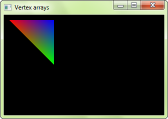
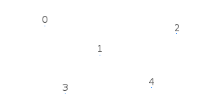
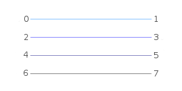
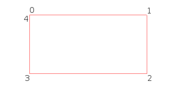
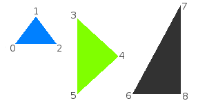
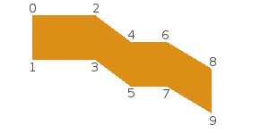
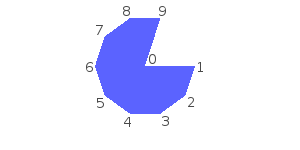
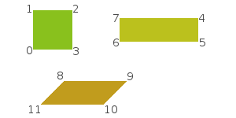
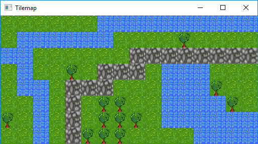
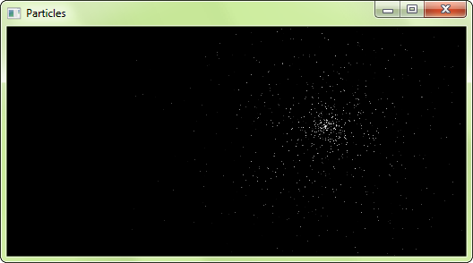

# Concevoir ses entités avec les tableaux de vertex

!!! warning ""

    Vous lisez le tutoriel pour SFML 2.2. Consultez la [dernière version de ce tutoriel](/fr/tutorials/latest/graphics/vertex-array/).

## Introduction

SFML fournit des classes simples pour les entités 2D les plus utilisées. Et, bien qu'il soit toujours possible de construire les entités plus complexes à partir de ces briques de bases, ce n'est pas toujours la solution la plus efficace. Par exemple, vous atteindrez très rapidement les limites de votre carte graphique si vous dessinez un grand nombre de sprites. La raison est la suivante : les performances sont directement liées au nombre d'appels à la fonction `draw`. En effet, chaque appel implique de changer tout un tas d'états OpenGL, de mettre en place des matrices, de changer de texture courante, etc. Et tout ce processus uniquement pour dessiner deux triangles (un sprite). Ce n'est pas vraiment ce que votre carte graphique attend : les cartes graphiques modernes sont plutôt conçues pour traiter les triangles par lots de plusieurs milliers, voire millions.

Afin de combler ce fossé, SFML fournit un mécanisme de plus bas niveau pour dessiner des choses : les tableaux de vertex (*vertex arrays* en anglais ou pour les habitués). En fait, les tableaux de vertex sont utilisés en interne par toutes les autres classes de SFML. Ils permettent une définition plus flexible des entités 2D, contenant autant de triangles qu'il vous faut. Ils permettent même de dessiner des points ou des lignes.

## Qu'est-ce qu'un vertex, et pourquoi sont-ils toujours dans des tableaux ?

Un vertex (ou encore "sommet") est la plus petite entité graphique que vous pouvez manipuler. En bref, c'est un point graphique : il contient bien entendu une position 2D (x, y), mais aussi une couleur, et une paire de coordonnées de texture. Nous verrons plus tard le rôle de ces attributs.

Les vertex seuls ne servent pas à grand chose. Ils sont toujours groupés en *primitives* : des points (1 vertex), des lignes (2 vertex), des triangles (3 vertex) ou bien des quads (4 vertex). Puis, avec une ou plusieurs de ces primitives, vous formez enfin la géometrie finale de l'entité.

Vous comprenez maintenant pourquoi on parle toujours de tableaux de vertex, et non pas de vertex tous seuls.

## Un tableau de vertex simple

Tout d'abord, jettons un oeil à la classe [`sf::Vertex`](../../../documentation/2.2/classsf_1_1Vertex.html "sf::Vertex documentation"). C'est un type simple qui contient trois membres publics, et aucune fonction excepté ses constructeurs. Ces derniers permettent de créer des vertex avec uniquement les attributs dont vous avez besoin -- vous ne voudrez pas toujours colorer ou texturer votre entité.

```cpp
// création d'un nouveau vertex
sf::Vertex vertex;

// on change sa position
vertex.position = sf::Vector2f(10, 50);

// on change sa couleur
vertex.color = sf::Color::Red;

// on change ses coordonnées de texture
vertex.texCoords = sf::Vector2f(100, 100);
```

... ou bien, en utilisant le constructeur adéquat :

```cpp
sf::Vertex vertex(sf::Vector2f(10, 50), sf::Color::Red, sf::Vector2f(100, 100));
```

Maintenant, définissons une primitive. Rappelez-vous, une primitive est faite de plusieurs vertex, il nous faudra donc un tableau de vertex. SFML fournit une encapsulation simple d'utilisation pour ces derniers : [`sf::VertexArray`](../../../documentation/2.2/classsf_1_1VertexArray.html "sf::VertexArray documentation"). Cette classe a la même sémantique qu'un tableau (similaire à `std::vector` par exemple), et elle stocke également le type de primitives directement.

```cpp
// création d'un tableau de 3 vertex définissant un triangle
sf::VertexArray triangle(sf::Triangles, 3);

// on définit la position des sommets du triangle
triangle[0].position = sf::Vector2f(10, 10);
triangle[1].position = sf::Vector2f(100, 10);
triangle[2].position = sf::Vector2f(100, 100);

// on définit la couleur des sommets du triangle
triangle[0].color = sf::Color::Red;
triangle[1].color = sf::Color::Blue;
triangle[2].color = sf::Color::Green;

// pas de coordonnées de texture ici, nous verrons ça plus tard
```

Le triangle est prêt, il peut maintenant être dessiné. Dessiner un tableau de vertex est similaire au dessin de n'importe quelle autre entité SFML, avec la fonction `draw` :

```cpp
window.draw(triangle);
```



Vous pouvez remarquer que la couleur des vertex est interpolée pour remplir la primitive ; c'est un moyen sympa de créer des dégradés.

Notez que vous n'êtes pas forcés d'utiliser la classe [`sf::VertexArray`](../../../documentation/2.2/classsf_1_1VertexArray.html "sf::VertexArray documentation"). Elle existe pour vous simplifier la vie, elle n'est rien d'autre qu'un `std::vector<sf::Vertex>` avec un `sf::PrimitiveType`. Si vous voulez plus de flexibilité, ou bien un tableau non-dynamique, vous pouvez utiliser votre propre conteneur à vertex. Vous devrez ensuite utiliser la surcharge de la fonction `draw` qui prend en paramètre un pointeur vers les vertex, leur nombre et le type de primitive.

```cpp
std::vector<sf::Vertex> vertices;
vertices.push_back(sf::Vertex(...));
...

window.draw(&vertices[0], vertices.size(), sf::Triangles);
```

```cpp
sf::Vertex vertices[2] =
{
    sf::Vertex(...),
    sf::Vertex(...)
};

window.draw(vertices, 2, sf::Lines);
```

## Les types de primitives

Faisons une pause, et regardons quel genre de primitives il est possible de créer avec des vertex. Comme expliqué plus haut, vous pouvez définir les primitives 2D les plus basiques : point, ligne, triangle et quad (à vrai dire, ce dernier n'existe que par souci de simplification, en interne la carte graphique va le découper en une paire de triangles). Il existe aussi des variantes "chaînées" de ces types, qui permettent de partager des vertex entre deux primitives adjacentes -- ce qui est vraiment utile car la plupart du temps les primitives d'une même entité sont connectées.

Voici la liste complète :

| Type de primitive | Description | Exemple |
| --- | --- | --- |
| `sf::Points` | Un ensemble de points non connectés. Ces points n'ont pas d'épaisseur : ils occuperont toujours un pixel, indépendamment de la transformation ou vue courante. |  |
| `sf::Lines` | Un ensemble de lignes non connectées. Ces lignes n'ont pas d'épaisseur : elles feront toujours un pixel de large, indépendamment de la transformation ou vue courante. |  |
| `sf::LinesStrip` | Un ensemble de lignes connectées. Le second vertex d'une ligne est utilisé comme premier vertex de la suivante. |  |
| `sf::Triangles` | Un ensemble de triangles non connectés. |  |
| `sf::TrianglesStrip` | Un ensemble de triangles connectés par un côté. Chaque triangle partage ses deux derniers vertex avec le suivant. |  |
| `sf::TrianglesFan` | Un ensemble de triangles connectés à un point central (en éventail). Le tout premier vertex est le centre, puis chaque nouveau vertex définit un nouveau triangle, combiné au centre et au vertex suivant. |  |
| `sf::Quads` | Un ensemble de quads non connectés. Les 4 points d'un quad doivent être définis soit dans le sens des aiguilles d'une montre, soit dans le sens inverse. |  |

## Texturage

Comme les autres entités SFML, les tableaux de vertex peuvent être texturés. Pour ce faire, il faut jouer avec l'attribut `texCoords` des vertex. Celui-ci définit quel pixel de la texture sera collé sur le vertex.

```cpp
// création d'un quad
sf::VertexArray quad(sf::Quads, 4);

// on le définit comme un rectangle, placé en (10, 10) et de taille 100x100
quad[0].position = sf::Vector2f(10, 10);
quad[1].position = sf::Vector2f(110, 10);
quad[2].position = sf::Vector2f(110, 110);
quad[3].position = sf::Vector2f(10, 110);

// et on définit la zone de texture à lui appliquer comme étant le rectangle de 25x50 démarrant en (0, 0)
quad[0].texCoords = sf::Vector2f(0, 0);
quad[1].texCoords = sf::Vector2f(25, 0);
quad[2].texCoords = sf::Vector2f(25, 50);
quad[3].texCoords = sf::Vector2f(0, 50);
```

!!! warning

    Les coordonnées de texture sont définies en *pixels* (tout comme le `textureRect` des sprites et des formes). Elles ne sont *pas* normalisées (entre 0 et 1), comme les personnes habituées à OpenGL pourraient s'y attendre.

Les tableaux de vertex sont des entités bas niveau, ils ne gèrent que la géometrie et ne stockent aucun attribut supplémentaire telle qu'une texture. Pour dessiner un tableau de vertex avec une texture, il faut donc la passer directement à la fonction `draw` :

```cpp
sf::VertexArray vertices;
sf::Texture texture;

...

window.draw(vertices, &texture);
```

Ceci est la version raccourcie, si vous devez passer d'autres états de rendu que la texture (comme un *blend mode* ou une transformation) vous pouvez utiliser la version explicite qui utilise une instance de [`sf::RenderStates`](../../../documentation/2.2/classsf_1_1RenderStates.html "sf::RenderStates documentation") :

```cpp
sf::VertexArray vertices;
sf::Texture texture;

...

sf::RenderStates states;
states.texture = &texture;

window.draw(vertices, states);
```

## Transformer un tableau de vertex

La transformation est similaire au texturage. Elle ne peut pas être associée directement au tableau de vertex, vous devez la passer à la fonction `draw`.

```cpp
sf::VertexArray vertices;
sf::Transform transform;

...

window.draw(vertices, transform);
```

Ou bien, si vous devez passer d'autres états :

```cpp
sf::VertexArray vertices;
sf::Transform transform;

...

sf::RenderStates states;
states.transform = transform;

window.draw(vertices, states);
```

Pour en apprendre plus sur les transformations et la classe [`sf::Transform`](../../../documentation/2.2/classsf_1_1Transform.html "sf::Transform documentation"), vous pouvez lire le tutoriel [Transformer des entités](transform.md "Tutoriel 'Transformer des entités'").

## Créer une entité SFML-like

Maintenant que vous savez comment définir votre propre entité colorée/texturée/transformée, est-ce que ce ne serait pas sympa de pouvoir l'encapsuler dans une classe similaire aux entités SFML ? Heureusement, SFML fournit tout ce qu'il faut pour faire ça simplement, avec les classes de base [`sf::Drawable`](../../../documentation/2.2/classsf_1_1Drawable.html "sf::Drawable documentation") et [`sf::Transformable`](../../../documentation/2.2/classsf_1_1Transformable.html "sf::Transformable documentation"). Ces deux classes sont les bases des entités SFML -- [`sf::Sprite`](../../../documentation/2.2/classsf_1_1Sprite.html "sf::Sprite documentation"), [`sf::Text`](../../../documentation/2.2/classsf_1_1Text.html "sf::Text documentation") et [`sf::Shape`](../../../documentation/2.2/classsf_1_1Shape.html "sf::Shape documentation").

[`sf::Drawable`](../../../documentation/2.2/classsf_1_1Drawable.html "sf::Drawable documentation") est une interface : elle déclare une unique fonction virtuelle pure ; aucun membre ou fonction concrète. Hériter de [`sf::Drawable`](../../../documentation/2.2/classsf_1_1Drawable.html "sf::Drawable documentation") permet de dessiner des instances de votre classe de la même manière que les classes SFML :

```cpp
class MyEntity : public sf::Drawable
{
private:

    virtual void draw(sf::RenderTarget& target, sf::RenderStates states) const;
};

MyEntity entity;
window.draw(entity); // appelle entity.draw en interne
```

Notez que ce n'est pas obligatoire, vous pourriez tout aussi bien avoir une fonction `draw` similaire dans votre classe, et l'appeler avec `entity.draw(window)`. Mais l'autre manière, avec [`sf::Drawable`](../../../documentation/2.2/classsf_1_1Drawable.html "sf::Drawable documentation") comme classe de base, est plus élégante et cohérente. Et si jamais vous devez un jour stocker un tableau d'objets dessinables, vous pourrez le faire sans effort supplémentaire puisque tous les objets dessinables (les vôtres et ceux de SFML) dérivent de la même classe.

L'autre classe de base, [`sf::Transformable`](../../../documentation/2.2/classsf_1_1Transformable.html "sf::Transformable documentation"), n'a pas de fonction virtuelle. En dériver ajoute automatiquement à votre classe les mêmes fonctions de transformation que les autres classes SFML (`setPosition`, `setRotation`, `move`, `scale`, ...). Vous pouvez en apprendre plus sur cette classe dans le tutoriel [Transformer des entités](transform.md "Tutoriel 'Transformer des entités'").

Donc, en utilisant ces deux classes de base et un tableau de vertex (et dans cet exemple nous allons aussi ajouter une texture), voici à quoi pourrait ressembler une classe SFML-like typique :

```cpp
class MyEntity : public sf::Drawable, public sf::Transformable
{
public:

    // ajoutez des fonctions pour jouer avec la géometrie / couleur / texture de l'entité...

private:

    virtual void draw(sf::RenderTarget& target, sf::RenderStates states) const
    {
        // on applique la transformation de l'entité -- on la combine avec celle qui a été passée par l'appelant
        states.transform *= getTransform(); // getTransform() est définie par sf::Transformable

        // on applique la texture
        states.texture = &m_texture;

        // on peut aussi surcharger states.shader ou states.blendMode si nécessaire

        // on dessine le tableau de vertex
        target.draw(m_vertices, states);
    }

    sf::VertexArray m_vertices;
    sf::Texture m_texture;
};
```

Vous pouvez ensuite jouer avec cette classe comme si c'était une classe SFML :

```cpp
MyEntity entity;

// vous pouvez la transformer
entity.setPosition(10, 50);
entity.setRotation(45);

// vous pouvez la dessiner
window.draw(entity);
```

## Exemple: tile map

Avec tout ce qu'on a vu précédemment, voyons maintenant un exemple complet (mains néanmoins simple) : créons une classe qui encapsule une tilemap, ie. un niveau composé de tuiles. Le niveau complet sera contenu dans un unique tableau de vertex, ainsi il sera extrêmement rapide à dessiner. Il faut noter que cette stratégie n'est applicable que si tout le tileset (la texture qui contient les tuiles) peut tenir dans une unique texture. Sinon, il faudra au minimum utiliser un tableau de vertex par texture.

```cpp
class TileMap : public sf::Drawable, public sf::Transformable
{
public:

    bool load(const std::string& tileset, sf::Vector2u tileSize, const int* tiles, unsigned int width, unsigned int height)
    {
        // on charge la texture du tileset
        if (!m_tileset.loadFromFile(tileset))
            return false;

        // on redimensionne le tableau de vertex pour qu'il puisse contenir tout le niveau
        m_vertices.setPrimitiveType(sf::Quads);
        m_vertices.resize(width * height * 4);

        // on remplit le tableau de vertex, avec un quad par tuile
        for (unsigned int i = 0; i < width; ++i)
            for (unsigned int j = 0; j < height; ++j)
            {
                // on récupère le numéro de tuile courant
                int tileNumber = tiles[i + j * width];

                // on en déduit sa position dans la texture du tileset
                int tu = tileNumber % (m_tileset.getSize().x / tileSize.x);
                int tv = tileNumber / (m_tileset.getSize().x / tileSize.x);

                // on récupère un pointeur vers le quad à définir dans le tableau de vertex
                sf::Vertex* quad = &m_vertices[(i + j * width) * 4];

                // on définit ses quatre coins
                quad[0].position = sf::Vector2f(i * tileSize.x, j * tileSize.y);
                quad[1].position = sf::Vector2f((i + 1) * tileSize.x, j * tileSize.y);
                quad[2].position = sf::Vector2f((i + 1) * tileSize.x, (j + 1) * tileSize.y);
                quad[3].position = sf::Vector2f(i * tileSize.x, (j + 1) * tileSize.y);

                // on définit ses quatre coordonnées de texture
                quad[0].texCoords = sf::Vector2f(tu * tileSize.x, tv * tileSize.y);
                quad[1].texCoords = sf::Vector2f((tu + 1) * tileSize.x, tv * tileSize.y);
                quad[2].texCoords = sf::Vector2f((tu + 1) * tileSize.x, (tv + 1) * tileSize.y);
                quad[3].texCoords = sf::Vector2f(tu * tileSize.x, (tv + 1) * tileSize.y);
            }

        return true;
    }

private:

    virtual void draw(sf::RenderTarget& target, sf::RenderStates states) const
    {
        // on applique la transformation
        states.transform *= getTransform();

        // on applique la texture du tileset
        states.texture = &m_tileset;

        // et on dessine enfin le tableau de vertex
        target.draw(m_vertices, states);
    }

    sf::VertexArray m_vertices;
    sf::Texture m_tileset;
};
```

Et maintenant, l'application qui l'utilise :

```cpp
int main()
{
    // on crée la fenêtre
    sf::RenderWindow window(sf::VideoMode(512, 256), "Tilemap");

    // on définit le niveau à l'aide de numéro de tuiles
    const int level[] =
    {
        0, 0, 0, 0, 0, 0, 1, 1, 1, 1, 1, 1, 1, 1, 1, 1,
        0, 1, 1, 1, 1, 1, 1, 0, 0, 0, 0, 2, 0, 0, 0, 0,
        1, 1, 0, 0, 0, 0, 0, 0, 3, 3, 3, 3, 3, 3, 3, 3,
        0, 1, 0, 0, 2, 0, 3, 3, 3, 0, 1, 1, 1, 0, 0, 0,
        0, 1, 1, 0, 3, 3, 3, 0, 0, 0, 1, 1, 1, 2, 0, 0,
        0, 0, 1, 0, 3, 0, 2, 2, 0, 0, 1, 1, 1, 1, 2, 0,
        2, 0, 1, 0, 3, 0, 2, 2, 2, 0, 1, 1, 1, 1, 1, 1,
        0, 0, 1, 0, 3, 2, 2, 2, 0, 0, 0, 0, 1, 1, 1, 1,
    };

    // on crée la tilemap avec le niveau précédemment défini
    TileMap map;
    if (!map.load("tileset.png", sf::Vector2u(32, 32), level, 16, 8))
        return -1;

    // on fait tourner la boucle principale
    while (window.isOpen())
    {
        // on gère les évènements
        sf::Event event;
        while (window.pollEvent(event))
        {
            if(event.type == sf::Event::Closed)
                window.close();
        }

        // on dessine le niveau
        window.clear();
        window.draw(map);
        window.display();
    }

    return 0;
}
```



Vous pouvez télécharger le tileset utilisé pour cet exemple de tilemap [ici](vertex-array-tilemap-tileset.png "L'exemple tileset").

## Exemple: système de particules

Ce second exemple implémente une autre entité communément utilisée : le système de particules. Le nôtre sera relativement simple : pas de texture et aussi peu de paramètres que possible. Il démontre l'utilisation du type de primitive `sf::Points`, avec un tableau de vertex dynamique qui change à chaque frame.

```cpp
class ParticleSystem : public sf::Drawable, public sf::Transformable
{
public:

    ParticleSystem(unsigned int count) :
    m_particles(count),
    m_vertices(sf::Points, count),
    m_lifetime(sf::seconds(3)),
    m_emitter(0, 0)
    {
    }

    void setEmitter(sf::Vector2f position)
    {
        m_emitter = position;
    }

    void update(sf::Time elapsed)
    {
        for (std::size_t i = 0; i < m_particles.size(); ++i)
        {
            // on met à jour la durée de vie de la particule
            Particle& p = m_particles[i];
            p.lifetime -= elapsed;

            // si la particule est arrivée en fin de vie, on la réinitialise
            if (p.lifetime <= sf::Time::Zero)
                resetParticle(i);

            // on met à jour la position du vertex correspondant
            m_vertices[i].position += p.velocity * elapsed.asSeconds();

            // on met à jour l'alpha (transparence) de la particule en fonction de sa durée de vie
            float ratio = p.lifetime.asSeconds() / m_lifetime.asSeconds();
            m_vertices[i].color.a = static_cast<sf::Uint8>(ratio * 255);
        }
    }

private:

    virtual void draw(sf::RenderTarget& target, sf::RenderStates states) const
    {
        // on applique la transformation
        states.transform *= getTransform();

        // nos particules n'utilisent pas de texture
        states.texture = NULL;

        // on dessine enfin le vertex array
        target.draw(m_vertices, states);
    }

private:

    struct Particle
    {
        sf::Vector2f velocity;
        sf::Time lifetime;
    };

    void resetParticle(std::size_t index)
    {
        // on donne une vitesse et une durée de vie aléatoires à la particule
        float angle = (std::rand() % 360) * 3.14f / 180.f;
        float speed = (std::rand() % 50) + 50.f;
        m_particles[index].velocity = sf::Vector2f(std::cos(angle) * speed, std::sin(angle) * speed);
        m_particles[index].lifetime = sf::milliseconds((std::rand() % 2000) + 1000);

        // on remet à zéro la position du vertex correspondant à la particule
        m_vertices[index].position = m_emitter;
    }

    std::vector<Particle> m_particles;
    sf::VertexArray m_vertices;
    sf::Time m_lifetime;
    sf::Vector2f m_emitter;
};
```

Et la petite démo qui l'utilise :

```cpp
int main()
{
    // on crée la fenêtre
    sf::RenderWindow window(sf::VideoMode(512, 256), "Particles");

    // on crée un système de 1000 particules
    ParticleSystem particles(1000);

    // on crée un chrono pour mesurer le temps écoulé
    sf::Clock clock;

    // on fait tourner la boucle principale
    while (window.isOpen())
    {
        // on gère les évènements
        sf::Event event;
        while (window.pollEvent(event))
        {
            if(event.type == sf::Event::Closed)
                window.close();
        }

        // on fait en sorte que l'émetteur des particules suive la souris
        sf::Vector2i mouse = sf::Mouse::getPosition(window);
        particles.setEmitter(window.mapPixelToCoords(mouse));

        // on met à jour le système de particules
        sf::Time elapsed = clock.restart();
        particles.update(elapsed);

        // on le dessine
        window.clear();
        window.draw(particles);
        window.display();
    }

    return 0;
}
```


