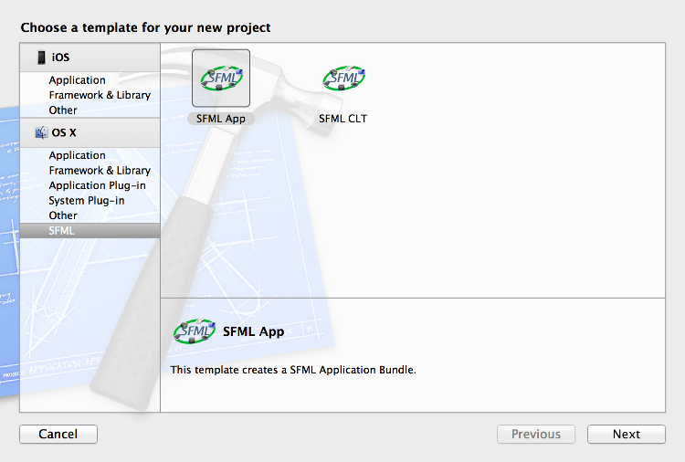
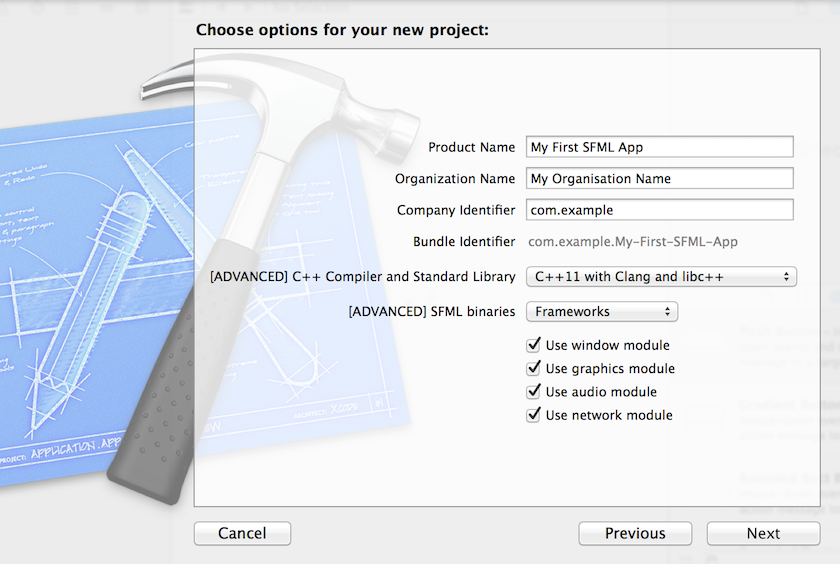
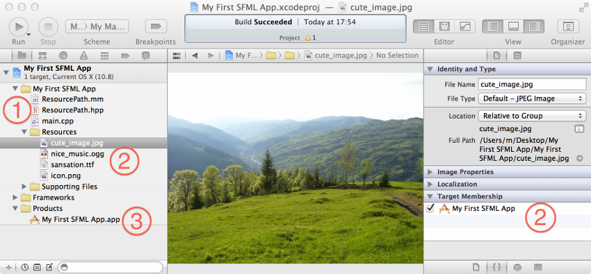

# SFML et Xcode (macOS)

## Introduction

Ceci est le premier tutoriel que vous devriez lire si vous utilisez SFML avec Xcode -- et de manière plus générale, si vous développez des applications pour macOS. Ce tutoriel vous montrera comment installer SFML, configurer votre EDI et compiler un programme SFML simple. Mais aussi, plus important, comment créer des applications qui soient prêtes à être utilisées "*out of the box*" pour l'utilisateur final.

Plusieurs liens sont donnés dans ce document. Ils sont là principalement pour les plus curieux d'entre vous ; vous n'avez pas besoin de les consulter pour suivre ce tutoriel.

### Les prérequis système

Tout ce dont vous avez besoin pour créer une application SFML est :

- un Mac Intel 64-bit avec Lion ou ultérieur (10.7+)
- avec [Xcode](http://developer.apple.com/xcode/ "Télécharger Xcode") (de préférence la quatrième, cinquième ou sixième version de l'EDI, qui est disponible sur l'*App Store*) et clang.

!!! warning

    Avec les versions récentes de Xcode vous devez aussi installer les `Command Line Tools` depuis `Xcode > Preferences > Downloads > Components`. Si vous ne trouvez pas les CLT dans Xcode, utilisez `xcode-select --install` dans un Terminal et suivez les instructions à l'écran.

### Les binaires : dylib contre framework

SFML est disponible en deux formats sous macOS. Vous avez les bibliothèques *dylib* d'un côté, et les bundles *framework* de l'autre.

- Dylib signifie "bibliothèque dynamique" ; ce format est similaire aux bibliothèques *.so* sous Linux. Vous pourrez trouver plus de détails dans [ce document](https://developer.apple.com/library/mac/#documentation/DeveloperTools/Conceptual/DynamicLibraries/ "Consulter la documentation d'Apple sur les dylibs").
- Les frameworks sont fondamentalement similaires aux dylibs, excepté qu'ils peuvent intégrer des ressources externes. Voici [la documentation détaillée](https://developer.apple.com/library/mac/#documentation/MacOSX/Conceptual/BPFrameworks/Frameworks.html "Consulter la documentation d'Apple sur les frameworks").

Il y a une seule différence importante entre ces deux types de bibliothèques à garder en tête lorsque vous développez des applications SFML : si vous compilez SFML vous-même, vous pouvez créer les dylibs en version *release* et *debug*. Par contre, les frameworks ne sont disponibles qu'en version *release*. Ceci ne sera toutefois pas un problème car quand vous distribuerez votre application aux utilisateurs finaux il est préférable d'utiliser la version *release* de SFML. C'est pourquoi les binaires pour OS X disponibles sur [la page de téléchargements](../../../download/index.md "Aller à la page des téléchargements") sont uniquement en version *release*.

### Les templates Xcode

SFML est livrée avec deux templates pour Xcode 4+ qui vous permettent de créer très rapidement et facilement de nouveaux projets d'applications. Ces templates peuvent créer des projets personnalisés : vous pouvez selectionner les modules dont votre application a besoin, choisir d'utiliser SFML en tant que dylib ou framework et décider entre créer un bundle d'application contenant toutes ses ressources (rendant l'installation de votre application aussi simple qu'un glisser-déposer) ou bien un binaire classique. Voyez plus bas pour plus de détails.

!!! warning

    Soyez conscients que ces templates ne sont pas compatibles avec Xcode 3. Si vous utilisez toujours cette version de l'EDI et ne comptez pas le mettre à jour, vous pourrez toujours créer des applications SFML bien entendu, mais nous n'aborderons pas la manière de faire dans ce tutoriel. Veuillez vous rapporter à la documentation d'Apple concernant Xcode 3, et plus particulièrement regarder comment ajouter une bibliothèque à votre projet.

### C++11, libc++ et libstdc++

Apple fournit une version personnalisée de `clang` et `libc++` avec Xcode, qui supportent standard C++11. Si vous avez prévu d'utiliser ces nouvelles fonctionnalités, vous devez configurer votre projet pour utiliser `clang` et `libc++`.

Cependant, si votre projet dépend (indirectement ou non) de libstdc++ vous devez [compiler SFML vous-même](build-from-source.md "Compiler SFML avec CMake") et configurer votre projet en conséquence.

## Installer SFML

Tout d'abord, vous devez télécharger le SDK SFML qui se trouve sur la [page des téléchargements](../../../download/index.md "Aller à la page des téléchargements"). Puis, pour commencer à développer des applications SFML, vous devez installer les composants suivants :

- **Les fichiers d'en-tête et les bibliothèques**  
  SFML est fournie en dylib ou en framework. Nous recommandons d'utiliser les frameworks mais les deux peuvent être installés sur un même système.
    - *frameworks*  
      Copiez le contenu de `Frameworks` dans `/Library/Frameworks`.
    - *dylib*  
      Copiez le contenu de `lib` dans `/usr/local/lib` et copiez le contenu de `include` dans `/usr/local/include`.
- **Les dépendances de SFML**  
  SFML requiert seulement quelques bibliothèques externes sous macOS. Copiez le contenu de `extlibs` dans `/Library/Frameworks`.
- **Les templates Xcode**  
  Ce composant est optionnel mais il est fortement recommandé de l'installer. Copiez le dossier `SFML` de `templates` dans `~/Library/Developer/Xcode/Templates` (si besoin, créez d'abord l'arborescence de répertoires).

À noter que `/Library` peut être nommé `/Bibliothèque` si votre système est en français.

## Créer un premier programme SFML

Nous fournissons deux templates pour Xcode. `SFML CLT` génère un projet pour une application terminal classique alors que `SFML App` crée un projet pour un bundle d'application. Nous allons utiliser ce dernier ici mais ils fonctionnent de manière relativement similaire.

Tout d'abord, choisissez `File > New Project...` puis sélectionnez `SFML` dans la colonne de gauche et double cliquez sur `SFML App`.

Maintenant vous pouvez remplire les champs requis comme dans cette capture d'écran ; puis pressez `next`.

Votre nouveau projet est maintenant configuré pour créer un [bundle d'application ".app"](https://developer.apple.com/library/mac/#documentation/CoreFoundation/Conceptual/CFBundles/BundleTypes/BundleTypes.html "Consulter la documentation d'Apple sur les bundles d'application").

!!! warning

    Quelques mots à propos de la configuration des templates. Si vous choisissez une option incompatible pour `C++ Compiler and Standard Library`, vous allez rencontrer des erreurs à l'édition des liens. Faites bien attention à suivre cette ligne directrice :

- Si vous avez téléchargé la version "Clang" depuis la la page de téléchargement, vous devez choisir `C++11 with Clang and libc++`.
- Si vous avez compilé SFML vous-même, vous devriez savoir quelle option utiliser. ;-)

Maintenant que votre projet est prêt, voyons ce qu'il y a à l'intérieur :

Comme vous pouvez le voir, il y a déjà pas mal de fichiers dans le projet. Il y a trois catégories importantes :

1. **En-tête & fichiers sources :** le projet vient avec un exemple basique dans `main.cpp` et une fonction d'utilitaire : `std::string resourcePath(void);` dans `ResourcePath.hpp` et `ResourcePath.mm`. Le but de cette fonction, comme illustré dans l'exemple, est de fournir un moyen pratique d'accéder au répertoire `Resources` du bundle d'application.  
  Notez bien que cette fonction ne marche que sous macOS. Si vous prévoyez de porter votre application sur un autre OS, vous devrez faire une autre implémentation de cette fonction.
2. **Fichiers ressources :** les ressources de l'exemple de base sont mises dans ce répertoire et sont automatiquement copiées dans votre bundle d'application lorsque vous le compilez.  
  Pour ajouter de nouvelles ressources à votre projet, glissez-les simplement dans ce répertoire et assurez-vous qu'elles font partie de la cible de l'application, i.e. la case sous `Target Membership` dans la zone utilitaire (<kbd>cmd+alt+1</kbd>) doit être cochée.
3. **Produit :** c'est votre application. Cliquez simplement sur le bouton `Run` pour la tester.

Les autres fichier du projet ne sont pas très intéressants pour nous ici. Par contre, notez que les dépendances de SFML de votre projet sont ajoutées à votre bundle d'application, d'une manière similaire que les fichiers de ressources sont copiées, de sorte que l'application puisse s'exécuter directement sur un autre Mac sans aucune installation de SFML ou de ses dépendances.
