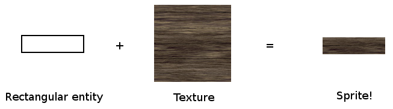
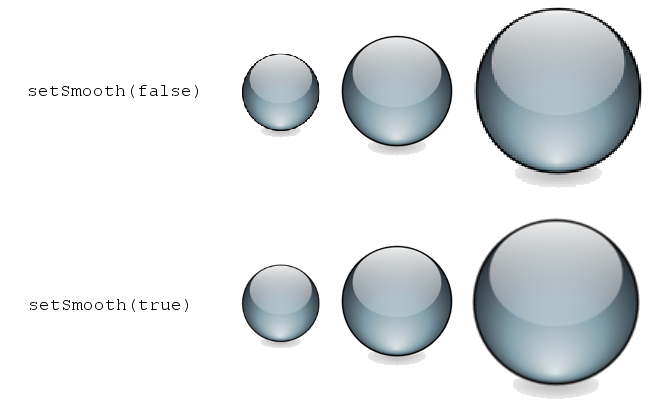
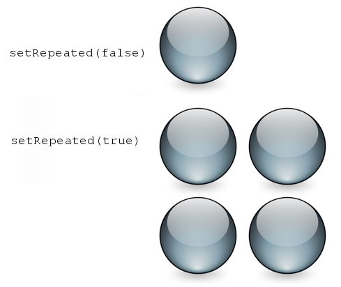
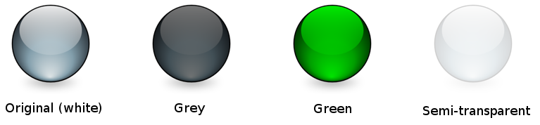

# Sprites et textures

!!! warning ""

    Vous lisez le tutoriel pour SFML 2.4. Consultez la [dernière version de ce tutoriel](/fr/tutorials/latest/graphics/sprite/).

## Vocabulaire

La plupart d'entre vous sont déjà familiers avec ces deux entités très communes, allons donc à l'essentiel.

Une texture est une image. Mais elle s'appelle "texture" car elle a un rôle bien précis : être "plaquée" sur une entité 2D.

Un sprite quant à lui n'est rien de plus qu'un rectangle texturé.



Ok, c'était plutôt court mais si vous ne comprenez vraiment pas ce que sont les sprites et les textures, alors vous en trouverez une bien meilleure description sur Wikipedia.

## Charger une texture

Ainsi donc, avant de créer le moindre sprite, il faut une texture valide. La classe qui encapsule les textures dans SFML est, ô surprise, [`sf::Texture`](https://www.sfml-dev.org/documentation/2.4.2-fr/classsf_1_1Texture.php "sf::Texture documentation"). Comme le (seul) rôle d'une texture est d'être chargée puis plaquée sur des entités graphiques, presque toutes ses fonctions servent à la charger ou mettre à jour son contenu.

La façon la plus commune de charger une texture est depuis une image sur le disque dur, ce qui se fait avec la fonction `loadFromFile`.

```cpp
sf::Texture texture;
if (!texture.loadFromFile("image.png"))
{
    // erreur...
}
```

!!! warning

    La fonction `loadFromFile` échoue parfois sans raison apparente. Première chose à faire, vérifiez le message d'erreur affiché par SFML dans la sortie standard (la console). Si le message est "unable to open file", assurez-vous que le *répertoire de travail* (qui est le répertoire relativement auquel tout fichier sera interprété) est celui auquel vous vous attendez : lorsque vous lancez votre application depuis l'explorateur de fichiers, le répertoire de travail est le répertoire de l'exécutable, pas de problème généralement dans ce cas ; mais si vous lancez votre programme depuis votre EDI (Visual Studio, Code::Blocks, ...) alors le répertoire de travail est parfois le répertoire du *projet*. Pas de panique : cela peut normalement être modifié directement dans les options de votre projet.

Vous pouvez aussi charger une image depuis un fichier en mémoire (`loadFromMemory`), depuis un [flux d'entrée](../system/stream.md "Tutoriels sur les flux d'entrée") (`loadFromStream`), ou encore depuis une image déjà chargée (`loadFromImage`). Cette dernière fonction charge la texture depuis un [`sf::Image`](https://www.sfml-dev.org/documentation/2.4.2-fr/classsf_1_1Image.php "sf::Image documentation"), qui est une classe utilitaire pour manipuler des images (modifier des pixels, créer un masque de transparence, etc.) Les pixels d'un [`sf::Image`](https://www.sfml-dev.org/documentation/2.4.2-fr/classsf_1_1Image.php "sf::Image documentation") restent en mémoire système, afin que les opérations sur ceux-ci soient le plus rapide possible, alors que les pixels d'une texture sont stockés en mémoire graphique et sont donc très lents à récupérer ou à mettre à jour -- mais extrêmement rapides à dessiner.

SFML supporte les formats de fichiers les plus communs. La liste complète est disponible dans la documentation de l'API.

Toutes ces fonctions de chargement ont un paramètre optionnel, qui peut être utilisé si vous voulez charger uniquement une partie de l'image.

```cpp
// chargement d'un sous-rectangle de 32x32 démarrant en (10, 10)
if (!texture.loadFromFile("image.png", sf::IntRect(10, 10, 32, 32)))
{
    // erreur...
}
```

[`sf::IntRect`](https://www.sfml-dev.org/documentation/2.4.2-fr/classsf_1_1Rect.php "sf::IntRect documentation") est une classe utilitaire qui représente un rectangle. Son constructeur prend les coordonnées du coin haut-gauche ainsi que la taille du rectangle.

Si vous ne voulez pas charger une texture depuis une image, mais plutôt la mettre à jour directement à partir d'un tableau de pixels, vous pouvez la créer vide puis la remplir plus tard :

```cpp
// création d'une texture vide de 200x200
if (!texture.create(200, 200))
{
    // erreur...
}
```

Notez que le contenu de la texture est complètement indéterminé à ce moment.

Pour mettre à jour les pixels d'une texture, il faut utiliser la fonction `update`. Elle possède des surcharges qui prennent en charge plusieurs sources possibles pour les pixels :

```cpp
// mise à jour d'une texture à partir d'un tableau de pixels
sf::Uint8* pixels = new sf::Uint8[width * height * 4]; // * 4 car les pixels ont 4 composantes (RGBA)
...
texture.update(pixels);

// mise à jour d'une texture à partir d'un sf::Image
sf::Image image;
...
texture.update(image);

// mise à jour d'une texture à partir du contenu d'une fenêtre
sf::RenderWindow window;
...
texture.update(window);
```

Ces exemples supposent tous que la source a la même taille que la texture. Si ce n'est pas le cas, i.e. si vous voulez mettre à jour uniquement une partie de la texture, vous pouvez spécifier les coordonnées du sous-rectangle à mettre à jour. Vous pouvez vous référer à la documentation pour plus de détails.

En plus des fonctions de chargement et de mise à jour, une texture possède deux propriétés qui permettent de définir la façon dont elle est dessinée.

La première propriété permet de lisser la texture. Lisser une texture rend ses pixels moins visibles (mais un peu plus flous), ce qui peut être très important si elle n'est pas dessinée à sa taille d'origine.

```cpp
texture.setSmooth(true);
```



!!! warning

    Comme le lissage fait une interpolation entre les pixels adjacents de la texture, cela peut avoir l'effet de bord non souhaité de faire apparaître des pixels qui se trouvent en dehors de la région de la texture qui a été choisie. Cela peut notamment arriver lorsque votre sprite se trouve à des coordonnées non entières.

La seconde propriété permet de répéter une texture (dans les sprites qui sont correctement paramétrés).

```cpp
texture.setRepeated(true);
```



Cela ne fonctionnera que si le sprite qui affiche la texture est paramétré pour afficher un rectangle plus grand que la texture. Dans le cas contraire, cette propriété n'a aucun effet.

## Bon, je peux avoir mon sprite maintenant ?

Oui, vous pouvez maintenant créer votre sprite.

```cpp
sf::Sprite sprite;
sprite.setTexture(texture);
```

... et enfin le dessiner.

```cpp
// dans la boucle principale, entre window.clear() et window.display()
window.draw(sprite);
```

Si vous ne voulez pas que le sprite montre la totalité de la texture, vous pouvez changer son "rectangle de texture".

```cpp
sprite.setTextureRect(sf::IntRect(10, 10, 32, 32));
```

Vous pouvez aussi changer la couleur d'un sprite. La couleur choisie est modulée (multipliée) avec la texture du sprite. Changer la couleur peut aussi servir à changer la transparence globale du sprite.

```cpp
sprite.setColor(sf::Color(0, 255, 0)); // vert
sprite.setColor(sf::Color(255, 255, 255, 128)); // à moitié transparent
```

Ces sprites utilisent tous la même texture, mais ont une couleur différente :



Les sprites peuvent aussi être transformés : ils ont une position, une orientation et une échelle.

```cpp
// position
sprite.setPosition(sf::Vector2f(10, 50)); // position absolue
sprite.move(sf::Vector2f(5, 10)); // décalage relatif à la position actuelle

// rotation
sprite.setRotation(90); // angle absolu
sprite.rotate(15); // rotation par rapport à l'orientation actuelle

// scale
sprite.setScale(sf::Vector2f(0.5f, 2.f)); // facteurs d'échelle absolus
sprite.scale(sf::Vector2f(1.5f, 3.f)); // facters d'échelle relatifs à l'échelle actuelle
```

Par défaut, l'origine de ces trois transformations est le coin haut-gauche du sprite. Si vous souhaitez utiliser une origine différente (par exemple le centre du sprite, ou bien un autre coin), vous pouvez utiliser la fonction `setOrigin`.

```cpp
sprite.setOrigin(sf::Vector2f(25, 25));
```

Les transformations étant communes à toutes les entités de SFML, elles sont expliquées plus en détail dans leur propre tutoriel : [Transformer les entités](transform.md "Tutoriel 'Transformer les entités'").

## Le problème du carré blanc

Vous avez correctement chargé une texture, défini un sprite l'utilisant, et... tout ce que vous voyez à l'écran est un carré blanc. Que se passe-t-il ?

C'est une erreur courante. Lorsque vous définissez la texture d'un sprite, tout ce que celui-ci fait est de garder un *pointeur* vers la texture. Par conséquent, si celle-ci est détruite ou bien déplacée en mémoire par la suite, le sprite se retrouve avec un pointeur invalide, et ne peux plus être dessiné correctement.

Ce problème survient notamment lorsque vous écrivez ce genre de fonction :

```cpp
sf::Sprite loadSprite(std::string filename)
{
    sf::Texture texture;
    texture.loadFromFile(filename);

    return sf::Sprite(texture);
} //erreur : la texture est détruite ici !
```

Vous devez correctement gérer la durée de vie de vos textures, de sorte qu'elles restent en vie aussi longtemps qu'elles sont utilisées par des sprites.

## L'importance d'utiliser aussi peu de textures que possible

Utiliser un nombre réduit de textures est globalement une bonne stratégie, et la raison en est simple : changer la texture courante est une opération coûteuse pour la carte graphique. Dessiner plusieurs sprites qui utilisent la même texture donnera des performances optimales.

De plus, utiliser une unique texture vous permettra si nécessaire de regrouper toute la géometrie statique en une seule entité (vous ne pouvez en effet utiliser qu'une seule texture par appel à la fonction `draw`), ce qui sera nettement plus performant que de dessiner un groupe de plusieurs entités. Regrouper la géometrie statique implique d'autres classes et est donc hors sujet dans ce tutoriel, pour plus de détails vous pouvez aller voir le tutoriel sur [les tableaux de vertex](vertex-array.md "Tutoriel sur les tableaux de vertex").

Gardez bien cela en tête lorsque vous créez vos textures d'animation ou de tuiles (*sprite sheets* et *tilesets*) : utilisez si possible une seule texture.

## Utiliser sf::Texture dans du code OpenGL

Si vous utilisez OpenGL plutôt que les entités graphiques de SFML, vous pouvez toujours utiliser [`sf::Texture`](https://www.sfml-dev.org/documentation/2.4.2-fr/classsf_1_1Texture.php "sf::Texture documentation") comme encapsulation d'une texture OpenGL, et la faire intéragir avec vos entités OpenGL.

Afin d'activer une [`sf::Texture`](https://www.sfml-dev.org/documentation/2.4.2-fr/classsf_1_1Texture.php "sf::Texture documentation") pour le rendu (l'équivalent de `glBindTexture`), vous devez appeler la fonction statique `bind` :

```cpp
sf::Texture texture;
...

// activation de la texture
sf::Texture::bind(&texture);

// dessinez votre géometrie OpenGL ici...

// pas de texture
sf::Texture::bind(NULL);
```
