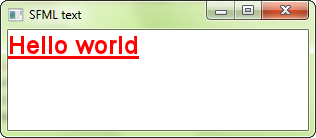

# Texte et polices

!!! warning ""

    Vous lisez le tutoriel pour SFML 2.6. Consultez la [dernière version de ce tutoriel](/fr/tutorials/latest/graphics/text/).

## Charger une police

Avant de dessiner du texte, vous avez besoin d'une police de caractères -- tout comme n'importe quel autre programme qui affiche du texte. Les polices sont encapsulées dans la classe [`sf::Font`](../../../documentation/2.6.2/classsf_1_1Font.html "sf::Font documentation"), qui fournit trois fonctionnalités principales : charger une police, récupérer ses glyphes (i.e. les caractères graphiques), et lire ses divers attributs. Il est très probable que la plupart du temps vous n'ayiez qu'à vous préoccuper de la première, à savoir charger des polices. C'est donc par celle-ci que nous allons commencer.

La façon la plus commune de charger une police est depuis un fichier sur le disque dur, ce qui est fait avec la fonction `loadFromFile`.

```cpp
sf::Font font;
if (!font.loadFromFile("arial.ttf"))
{
    // erreur...
}
```

Notez que SFML est incapable de charger les polices de votre système automatiquement, en d'autres termes `font.loadFromFile("Courier New")` ne fonctionnera pas. Premièrement parce que SFML demande un *nom de fichier*, pas un nom de police, et deuxièmement parce que SFML n'a aucun accès magique au répertoire de polices de votre OS. Ainsi, si vous voulez charger une police de caractères dans votre programme SFML, vous devez avoir son fichier (.ttf ou autre) dans votre application, comme n'importe quelle autre ressource (images, sons, ...).

!!! warning

    La fonction `loadFromFile` échoue parfois sans raison apparente. Première chose à faire, vérifiez le message d'erreur affiché par SFML dans la sortie standard (la console). Si le message est "unable to open file", assurez-vous que le *répertoire de travail* (qui est le répertoire relativement auquel tout fichier sera interprété) est celui auquel vous vous attendez : lorsque vous lancez votre application depuis l'explorateur de fichiers, le répertoire de travail est le répertoire de l'exécutable, pas de problème généralement dans ce cas ; mais si vous lancez votre programme depuis votre EDI (Visual Studio, Code::Blocks, ...) alors le répertoire de travail est parfois le répertoire du *projet*. Pas de panique : cela peut normalement être modifié directement dans les options de votre projet.

Vous pouvez aussi charger un fichier de police depuis la mémoire (`loadFromMemory`), ou depuis un [flux d'entrée](../system/stream.md "Tutoriel sur les flux d'entrée") (`loadFromStream`).

SFML supporte les formats de police les plus communs. La liste complète est disponible dans la documentation de l'API.

Voilà. Une fois votre police chargée, vous pouvez commencer à dessiner du texte.

## Dessiner du texte

Pour dessiner du texte, il faut utiliser la classe [`sf::Text`](../../../documentation/2.6.2/classsf_1_1Text.html "sf::Text documentation"). Elle est très simple à utiliser :

```cpp
sf::Text text;

// choix de la police à utiliser
text.setFont(font); // font est un sf::Font

// choix de la chaîne de caractères à afficher
text.setString("Hello world");

// choix de la taille des caractères
text.setCharacterSize(24); // exprimée en pixels, pas en points !

// choix de la couleur du texte
text.setFillColor(sf::Color::Red);

// choix du style du texte
text.setStyle(sf::Text::Bold | sf::Text::Underlined);

...

// puis, dans la boucle de dessin, entre window.clear() et window.display()
window.draw(text);
```



Les textes peuvent aussi être transformés : ils ont une position, une orientation et une échelle. Les fonctions impliquées sont les mêmes que pour la classe [`sf::Sprite`](../../../documentation/2.6.2/classsf_1_1Sprite.html "sf::Sprite documentation") ainsi que les autres entités SFML, et sont détaillées dans le tutoriel [Transformer des entités](transform.md "Tutoriel 'Transformer des entités'").

## Comment éviter les embrouilles avec les caractères non-ASCII ?

Gérer les caractères non-ASCII correctement (tels que les caractères européens accentués, arabes, ou encore chinois) peut poser beaucoup de problèmes si on ne s'y prend pas bien dès le départ. Cela requiert une bonne connaissance des différents encodages utilisés dans le processus d'interprétation et de dessin du texte. Afin de ne pas s'encombrer avec ces considérations, il existe une solution très simple : les *chaînes littérales larges* (*wide strings*).

```cpp
text.setString(L"éèàç");
```

Oui, c'est ce petit "L" devant la chaîne qui fait tout fonctionner sans encombre, en disant au compilateur de produire directement une chaîne "large". La chaîne large est une bestiole assez étrange en C++ : le standard ne mentionne ni sa taille (16 bits ? 32 bits ?) ni l'encodage qu'elle utilise (UTF-16 ? UTF-32 ?). Cependant, nous savons que sur la plupart des plateformes, sinon toutes, elles vont produire des chaînes Unicode, et SFML sait parfaitement les gérer correctement.

Notez que le standard C++11 supporte des nouveaux préfixes et types de caractères, pour produire des chaînes littérales UTF-8, UTF-16 et UTF-32, mais SFML ne les supporte pas encore.

Cela peut paraître évident, mais il est toujours bon de le rappeler : une police doit bien entendu contenir les caractères que vous lui faites afficher. En effet, les polices de caractères ne peuvent pas définir tous les caractères possibles (il y en a plus de 100000 dans le standard Unicode !), et une police arabe ne pourra pas afficher de caractères japonais, par exemple.

## Fabriquer sa propre classe de texte

!!! advanced "Sujet avancé"

    La suite de ce tutoriel explique comment afficher du texte vous-même à partir des glyphes d'une police.
    `sf::Text` couvre la plupart des besoins, vous pouvez donc la passer.

Si [`sf::Text`](../../../documentation/2.6.2/classsf_1_1Text.html "sf::Text documentation") est trop limitée, ou si vous voulez faire autre chose avec les glyphes pré-rendus, [`sf::Font`](../../../documentation/2.6.2/classsf_1_1Font.html "sf::Font documentation") fournit tout ce qu'il vous faut pour exploiter la police autrement.

Premièrement, vous devez récupérer la texture qui contient tous les glyphes pré-rendus pour une taille donnée de caractère :

```cpp
const sf::Texture& texture = font.getTexture(characterSize);
```

Notez que les glyphes sont ajoutés à la texture à la demande. Il existe tant de caractères (souvenez-vous, plus de 100000) qu'il est impossible de tous les pré-générer lorsqu'une police est chargée. Au lieu de cela, ils sont rendus à la volée lorsque la fonction `getGlyph` est appelée (voir ci-dessous).

Pour faire quelque chose d'utile avec la texture des glyphes, il faut ensuite récupérer les coordonnées de textures des glyphes qu'elle contient :

```cpp
sf::Glyph glyph = font.getGlyph(character, characterSize, bold);
```

`character` est le code UTF-32 du glyphe que vous voulez récupérer. Vous devez aussi spécifier la taille de caractère, et en dernier paramètre, si vous voulez la version grasse ou normale du glyphe.

La structure [`sf::Glyph`](../../../documentation/2.6.2/classsf_1_1Glyph.html "sf::Glyph documentation") contient trois membres :

- `textureRect` contient les coordonnées de textures du glyphe dans la texture
- `bounds` est le rectangle englobant du glyphe, qui est à le positionner relativement à la ligne de base du texte
- `advance` est le décalage horizontal à appliquer pour obtenir la position de départ du glyphe suivant dans le texte

Enfin, vous pouvez récupérer d'autres informations à propos de la police, telles que l'espacement entre les lignes ou le crénage (*kerning*), pour une taille de caractère donnée :

```cpp
int lineSpacing = font.getLineSpacing(characterSize);

int kerning = font.getKerning(character1, character2, characterSize);
```
